# 奥兰多三人旅行计划

**2026.12.04 周五晚入住 → 12.12 周六 18:30 从 MCO 乘国内航班离开**  
**版本：行程规划 v7（Reunion 住宿＋每日项目图片）｜资料核对：2026.11.15｜所有时间为佛罗里达当地时间（EST）**

> 这趟旅行的重点：Epic 完整一天，旧双园更偏重冒险岛；EPCOT 优先料理鼠王、银河护卫队和烟花；后半程每天一个自然主题，全程回同一间民宿。周边游才租车。
>
> 参考夏威夷行程的组织方式：速览 → 每日主线 → 看点与拍照 → 餐饮与交通 → 预约清单 → 临场取舍。原文件中的个人订单、预订状态和操作说明不沿用。

## 1. 已确认与待落地

| 项目 | 本版安排 |
| --- | --- |
| 人数 | 3 人 |
| 住宿 | 暂定 Reunion Resort 一楼三卧公寓，12/4–12/12 共 8 晚，全程不换住处；尚未确认预订 |
| 抵达 | 12/4 周五晚上入住；抵达航班和具体时间未提供 |
| 离开 | 12/12 周六 18:30，MCO 国内航班 |
| 环球 | Universal Islands of Adventure、Universal Studios Florida、Universal Epic Universe；拟买 3 日票 |
| 迪士尼 | 只去 EPCOT；不包含 Disney’s Hollywood Studios |
| 交通 | 乐园期间 Uber/Lyft；12/9 开始租车做周边游 |
| 偏好 | Epic ＞ 冒险岛 ＞ Universal Studios；保留拍照时间，后半程看风景 |
| 尚待确认 | 民宿订单与具体门牌／门禁说明、门票完整名称／有效期、是否选择 Sarasota 长途日、租车取还点 |

### 暂定住宿｜Reunion Resort 一楼公寓

**房源：公寓，带度假村＋一楼｜距离迪士尼 10 分钟**（房东 Rennata）。标题中的车程为房源宣传，不等于到 EPCOT 园门或环球的实际车程。

[打开 Airbnb 房源与本次日期：12/4–12/12、3 位成人](https://www.airbnb.cn/rooms/934030452168483857?check_in=2026-12-04&check_out=2026-12-12&adults=3)

| 项目 | 安排与注意事项 |
| --- | --- |
| 状态 | 加入行程的暂定住宿，尚未确认预订；2026/11/15 查询时这 8 晚显示可订 |
| 展示价格 | 查询时 ¥5,835 CNY／整套 8 晚，页面标注包含所有附加费用；最终付款金额与可订状态以结算页为准，不作为已付款记录 |
| 空间 | 一楼约 124 平方米，3 卧 2 卫；1 张 King＋2 张 Queen，三人可各住一间 |
| 设施 | 厨房、洗衣机／烘干机、阳台、免费停车；后半程租车后仍回这里休息 |
| 入住／退房 | 页面列 16:00 后入住、10:00 前退房，密码锁自助入住；周五晚到前确认门禁、司机进入方式与完整入住说明 |
| 取消条件 | 查询时显示预订后 24 小时内可免费取消，之后不可退款；付款前重看该订单完整政策 |
| 度假村设施 | 可使用部分泳池；水上乐园、高尔夫、网球会员区域不包含。部分会所需开车到达，前几天不为设施专门安排交通 |
| 生活用品 | 仅提供初始消耗品；8 晚需补水、早餐、纸品等。毛巾数量与是否可额外提供，入住前向房东确认 |

**乐园交通调整：** Reunion 位于迪士尼西南侧，不是环球旁边。房源住客曾反馈路况好时去环球约 30 分钟，但不能据此保证每天车程。12/5、12/6 旧双园及 12/7 Epic 均先按 **45–60 分钟路上缓冲**规划，再额外留叫车、安检和走到园门的时间；这是保守行程余量，不是逐段导航实测。拿到门牌后分别核对旧双园、Epic 和 EPCOT 的路线。EPCOT 也不按标题的“10 分钟”出发。

**每天如何使用这个住处：** 12/4 晚直接入住，简单补给；12/5–12/8 早上民宿吃早餐、打车去乐园，晚上回同一处；12/9–12/11 自驾周边游，下午或晚上回来洗衣休息；12/12 **10:00 前退房**，行李带上车，午餐后按计划去 MCO 还车。

**入住前待办：** 确认订单、准确门牌、门禁／网约车进入规则、晚到入住、停车规则与毛巾数量。现阶段未替你预订，也未联系房东。

“The Ringring”按 **The Ringling** 理解，地点在 **Sarasota**。它的美术馆、庄园和海湾花园很适合建筑与旅行照片。[Sarasota 官方旅游局介绍](https://www.visitsarasota.com/attractions-tours/ringling)

## 2. 一眼看懂每天安排

| 日期 | 主线 | 当天节奏 | 交通／晚上住哪里 |
| --- | --- | --- | --- |
| 12/4 周五 | 抵达、入住、休息 | 不安排额外任务 | 打车 → 民宿 |
| 12/5 周六 | **Islands of Adventure 冒险岛** | 完整乐园日；哈利波特与园区拍照 | 打车；回原民宿 |
| 12/6 周日 | **Studios 半日＋冒险岛补刷（需跨园票）** | 古灵阁、对角巷；下午补喜欢的冒险岛项目 | 打车；回原民宿 |
| 12/7 周一 | **Epic Universe＋Express** | 五个核心 ride、两场表演、白天与夜景 | 打车；回原民宿 |
| 12/8 周二 | **EPCOT 双核心＋烟花** | 料理鼠王、银河护卫队；烟花提前 75 分钟找位 | 打车；回原民宿 |
| 12/9 周三 | **Silver Springs 短线 kayak＋Ocala 午餐可选** | 上午取车；累了园内吃饭早回 | 开始租车；回原民宿 |
| 12/10 周四 | **King’s Landing／Emerald Cut＋Mount Dora 可选** | 上午看清泉，湖边午餐、短逛或直接回民宿 | 自驾；回原民宿 |
| 12/11 周五 | **可选：The Ringling＋Lido Beach**；轻松版改 Winter Park | 长途版看馆看海；轻松版咖啡公园 | 自驾；回原民宿 |
| 12/12 周六 | 民宿附近早午餐、收行李、还车、返程 | 不去远处、不排乐园 | 机场还车或打车；18:30 起飞 |

### 为什么这样排序

- **冒险岛放第一天**：优先级第二，完整给一天，先完成一座很想去的园。
- **周日 Studios 精选＋冒险岛补刷**：主路线需要跨园票；只买每天一园票则留 Studios。傍晚适时结束，为 Epic 保留睡眠。
- **Epic 放周一**：避开把最重视的园放在周末，且前一天可控制强度；这只是排程判断，不代表周一一定人少。
- **环球连续三天使用**：比穿插休息日更容易匹配票的使用窗口；购买前仍必须核对票种。
- **EPCOT 周二收尾**：之后全部切到自然风景；不再在后半程补一个高强度乐园。

**实际取舍：前四天仍是连续乐园日。** 本版通过控制周日补刷数量、每天坐下吃饭、使用合适的 Express 控制强度。如果三人中有人不适合连走四天，可用文末“恢复优先版”，代价是取消 Sarasota 长途日。

## 3. 先看门票，避免计划建立在错误票种上

### 环球 3 日票

不要只根据“3 日／3 园”中文名称下单。官方目前有可包含 Epic 的多日产品，但不同年份、销售渠道和优惠票的园区范围与有效期可能不同。[环球官方门票页](https://www.universalorlando.com/web/en/us/tickets-packages/park-tickets)

付款前逐项确认：

- [ ] 明确包含 **Epic Universe、Islands of Adventure、Universal Studios Florida** 三园。
- [ ] 使用窗口覆盖 **12/5、12/6、12/7**；Epic 如须单独选日，选择 **12/7**。
- [ ] 推荐 **Park-to-Park 跨园**，才能执行周日 Studios＋冒险岛；每天一园票则用周日一园备选。
- [ ] 是否能改日期、是否有额外预约要求；天气换日是否允许。
- [ ] 已确定计划购买 Express；逐日确认日期、覆盖园区、一次或 Unlimited，海格另查。

**霍格沃茨列车需要能在同日进入 Studios 和冒险岛的 Park-to-Park 权限。** 单园日票即使有三天，也不能据此乘车跨园。它只连接这两个园，不去 Epic。[霍格沃茨列车官方说明](https://www.universalorlando.com/web/en/us/things-to-do/rides-attractions/hogwarts-express?intsrch=new)

**本版建议：** 为把更多时间交给冒险岛，优先比较包含 Epic 的三日 Park-to-Park 票；若不升级，就一天一园，并把周六核心项目排在最前。Express 和跨园门票需分别核对。

### EPCOT

单独购买 **12/8 EPCOT 一日票**，核对预约要求。两个必玩是料理鼠王和银河护卫队；省排队方案可比较 **Guardians Single Pass＋EPCOT Multi Pass（优先 Remy）**，迪士尼 LL 与环球 Express 分开购买。民宿＋12/8 单日日期票按当前规则，目标 **12/5 07:00 EST** 查看三人可订时段；仍须以购买当日 App 为准。[迪士尼官方 LL 规则](https://disneyworld.disney.go.com/lightning-lane-passes/)

2026 年 EPCOT Festival of the Holidays 官方日期为 **11/27–12/30**，本次正好覆盖。可把节日小吃、装饰和季节演出融入逛园，不必额外堆满任务。[迪士尼节日活动页](https://disneyworld.disney.go.com/events-tours/epcot/holiday-festival/)

### 三人票价与购票方案｜2026/11/15 查询

**已按三名 10 岁以上成人报价；你们已确认三人均符合美国／加拿大居民促销资格。** 环球按 **12/5 起、12/5–12/7 使用**，EPCOT 按 **12/8**。金额均为美元；下面明确区分“选定日期看到的含税报价”和“未开放购买的 LL 预算”，没有代下单。

#### 先看三人总价

| 方案 | 三人金额 | 价格状态与限制 |
| --- | --- | --- |
| **环球：标准三日跨园票＋三日三园普通 Express** | **$2,857.38 含税** | 已在日期选为 12/5 的代理商页面看到单价；三园跨园更灵活 |
| **环球：旧双园跨园两天＋Epic 一天促销票＋三日三园普通 Express** | **$2,708.73 含税** | **优先推荐比较这组**，完全匹配目前路线；比上面省 **$148.65／三人**。Epic 那一天不能跨去旧双园 |
| **环球省钱备选：同一促销门票＋两日三园普通 Express** | **$2,344.50 含税** | 三天都有入园门票，但 Express 只用 **12/5、12/7**，12/6 普通排队；比三日 Express 再省 **$364.23／三人** |
| **EPCOT：12/8 三张一日一园门票** | **$587.88 含税** | 已在迪士尼官方选定日期、EPCOT、三名成人后看到小计；不包含 LL |
| **EPCOT：以上门票＋Multi Pass＋Guardians Single Pass** | **预算 $731.66–811.53／三人，含预估税** | **门票价已核，12/8 LL 确价尚未核到**；其中两种 LL 合计暂留 $143.78–223.65／三人含预估税 |
| **当前推荐的两家合计：环球促销票＋三日 Express＋EPCOT＋两种 LL** | **预算 $3,440.39–3,520.26／三人** | 环球和 EPCOT 门票按已查报价，LL 用预算；不含打车、餐饮、住宿、租车等 |

上述“推荐”是**本次已核对组合中更贴合路线的选择**，不代表全网最低价。环球官方日期购物页本次未能完整加载，故不将代理商的“对比门市省多少”当作独立核实的官网售价。付款前在官网与代理商都选同日期、同人数、同权限，比较最终含税总额。

#### 环球价格明细与直接购票链接

| 产品 | 单人含税 | 三人含税 | 购票入口与选项 |
| --- | --- | --- | --- |
| 标准 **Universal 3-Day (Park-to-Park)** | **$445.12** | **$1,335.36** | [Undercover Tourist 标准三日跨园票](https://www.undercovertourist.com/orlando/universal-3-day-park-to-park-ticket/)；选 **Dec 5, 2026／Adult 10+ ×3** |
| **2-Day (Park-to-Park) PLUS 1-Day Epic (PROMO)** | **$395.57** | **$1,186.71** | [旧双园两日跨园＋Epic 一日促销票](https://www.undercovertourist.com/orlando/universal-2-park-2-day-park-to-park-plus-1-day-epic-universe-ticket/)；选 **Dec 5, 2026／Adult 10+ ×3** |
| **3-Day 3-Park Universal Express Pass**，普通版 | **$507.34** | **$1,522.02** | [三日三园 Express](https://www.undercovertourist.com/orlando/universal-3-day-universal-express-pass-ticket/)；选 **Dec 5, 2026／Express All Ages ×3**；不是 Unlimited |
| **2-Day 3-Park Universal Express Pass**，普通版 | **$385.93** | **$1,157.79** | [两日三园 Express](https://www.undercovertourist.com/orlando/universal-2-day-universal-express-pass-ticket/)；选 **Dec 5, 2026** 起的使用窗口，计划用在 12/5 与 12/7 |

**这些报价来自已经选定日期的产品侧栏，不是日历里的“每天均价”，也不是页面未选日期时的 from 起价。** 页面显示税已含，不要再把税重复加一次；最终以付款页、数量和即时库存为准。单价乘三为本表三人金额，未扣任何宣传赠品。

**有效期区别：** 本次查看的标准三日门票与三日 Express 为 **12/5–12/9 五日窗口内任选三天**；两日 Express 为 **12/5–12/8 四日窗口内任选两天**；促销入园票为 **12/5–12/11 七日窗口**，其中旧双园两天跨园，Epic 在另一天单独使用。均覆盖当前行程，但门票和 Express 要分别满足各自窗口。[标准票条款](https://www.undercovertourist.com/orlando/universal-3-day-park-to-park-ticket/) · [促销票条款](https://www.undercovertourist.com/orlando/universal-2-park-2-day-park-to-park-plus-1-day-epic-universe-ticket/) · [三日 Express 条款](https://www.undercovertourist.com/orlando/universal-3-day-universal-express-pass-ticket/) · [两日 Express 条款](https://www.undercovertourist.com/orlando/universal-2-day-universal-express-pass-ticket/)

#### 环球怎么买更划算

1. **门票优先比较“旧双园两日跨园＋Epic 一日”促销票。** 12/5 冒险岛、12/6 Studios＋冒险岛、12/7 独立 Epic，权限正好够用；三人省 $148.65。若你们想在三天里自由多次进 Epic，或 Epic 当日也回旧双园，就选标准三日跨园。
2. **三天都想省排队，就按三日三园普通 Express 比价。** 不默认需要 Unlimited；你们已把更重要的目标分到三天，重复体验可按余量安排。要同日多刷绿巨人／迅猛龙，再比较旧双园 Unlimited 的日期报价，本次未核到该升级的指定日期总额。
3. **愿意周日慢一点才选两日 Express。** 用在最重要的 12/5 冒险岛与 12/7 Epic；12/6 古灵阁、木乃伊等走普通队，下午补刷随实际等待取舍。它确实省 $364.23，但不等价于“三天都有 Express”。原每日安排默认三日都有，采用省钱版须按本条调整。
4. **不要用 $99／天的三园单园促销替代跨园票。** 官方也有旧双园跨园两天＋Epic 一天 **$357 税前起**的产品，值得选你们日期复核；这里的起价不能直接当作 12/5 售价。[环球官方促销与升级说明](https://www.universalorlando.com/web/en/us/tickets-packages/deals-specials)
5. **赠送的 DiningDollars.com credit 不等于现金票款折扣。** 本次总额没有减掉这些 credit；要额外买礼品卡时再看兑换限制，不能默认能拿来支付代理商购物车里的门票或 Express。
6. **不为“多送两天”临时增加乐园。** 只有同日期、同权限的最终价格更低才买加赠天数产品；你们后半程的休息与风景安排仍保留。计划全程住 Reunion 民宿，不把另订酒店的 Express 权益算作无成本节省。

**海格需再确认：本次看到信息冲突。** 代理商 Express 产品清单列有 Hagrid’s，但环球官网 FAQ 仍将它列为不适用；出发前以所购产品最新条款、官方客服和现场为准。本版继续给海格保留普通队缓冲，不承诺这张 Express 一定覆盖它。[代理商清单](https://www.undercovertourist.com/orlando/universal-3-day-universal-express-pass-ticket/) · [官方 Express 条款](https://www.universalorlando.com/web/en/us/tickets-packages/express-passes)

**官方比价入口：** [环球门票](https://www.universalorlando.com/web/en/us/tickets-packages/park-tickets) · [官方 Express](https://www.universalorlando.com/web/en/us/tickets-packages/express-passes) · [官方促销](https://www.universalorlando.com/web/en/us/tickets-packages/deals-specials)。购票时核对 **Orlando，非 Hollywood**；门票是否跨园，与 Express 覆盖哪些园，是两件事。

#### EPCOT 门票＋Lightning Lane 多少钱

**门票已核实：** 在[迪士尼官方购票页面](https://disneyworld.disney.go.com/admission/tickets/theme-parks/)依次选择 **1 day → Dec 8, 2026 → EPCOT → Ages 10+ ×3**，看到 **$184／人税前，三人 $552＋$35.88 税＝$587.88**。一日一园即可，不加 Park Hopper。

| 项目 | 单人 | 三人 | 是否为 12/8 确认价格 |
| --- | --- | --- | --- |
| EPCOT 一日一园门票 | **$184 税前／$195.96 含税** | **$587.88 含税** | **是，官方日期选择器与三人小计** |
| Multi Pass，优先选择 Remy | **预算 $25–40 税前** | **预算 $79.88–127.80 含预估税** | **否**，是预留金额，不是实时报价 |
| Guardians Single Pass | **预算 $20–30 税前** | **预算 $63.90–95.85 含预估税** | **否**，是预留金额，不是实时报价 |
| 两种 LL 合计 | **预算 $45–70 税前** | **预算 $143.78–223.65 含预估税** | 待购买窗口确认 |
| 门票＋两种 LL 合计 | **预算约 $243.89–270.51 含预估税** | **预算 $731.66–811.53 含预估税** | 门票确认，LL 待确认 |

LL 预算参考近期价格记录后留出余量，税按本次官方门票小计对应的 **6.5%** 预估；四舍五入可能有几分钱差异，不作为报价上限。作参考，SupaPark 记录的 **11/15** EPCOT Multi Pass 为 $32、Guardians Single Pass 为 $23／人；**这是另一天的第三方记录，不是 12/8 的官方售价**。[近期价格记录](https://supapark.com/lightning-lane/multi-pass/prices)

**为什么现在不能给 12/8 LL 的准确合计：** 本次未核到该日期的可购买价格或三个重叠时段；你们住民宿，按当前单日票计划，可购买窗口是 **12/5 07:00 EST**。届时在 My Disney Experience 选择 12/8，先看 Remy 的可用时段，再与 Guardians 搭配，确认三人都有合适窗口后付款；不要只有 Multi Pass 却误以为它含 Guardians。[官方 LL 产品与购买规则](https://disneyworld.disney.go.com/lightning-lane-passes/)

**EPCOT 省钱顺序：** 一日一园、不买 Hopper；先保住两个核心的可行时段；Multi Pass 优先 Remy，其他预选放 Soarin’ 等顺路项目。若 Remy 无可用时段，重新评估 Multi Pass 是否还值得买，不能为了“已经打算买”就直接付钱。Premier Pass 为不指定回场时段的另一种更高价产品，本次未核日期价，也不列为你们的首选。

**购票与使用：** [EPCOT 官方门票选择器](https://disneyworld.disney.go.com/admission/tickets/theme-parks/) · [官方 LL 产品说明](https://disneyworld.disney.go.com/lightning-lane-passes/) · [My Disney Experience 下载与使用](https://disneyworld.disney.go.com/guest-services/my-disney-experience/mobile-apps/)。LL 实际购买在 App 内完成；门票须先关联三人账户。

### 当日排队与官方 App｜旅行当天点这里

**网页链接是打开时的当日队列，不是 12 月行程日期的预言。** 现在打开看到的是现在的情况；旅行当天再打开。第三方通常展示普通队的公布等待时间，**不是 Express 或 Lightning Lane 保证等待时间**，数据也可能延迟；临时停运、演出场次和入场安排优先看官方 App 与现场。

| 使用日 | 园区 | 打开当日排队页面 | 主要看什么 |
| --- | --- | --- | --- |
| **12/5 周六** | 冒险岛 | [冒险岛实时队列](https://queue-times.com/en-US/parks/64/queue_times) | 海格、迅猛龙、绿巨人是否运行，决定先后顺序 |
| **12/6 周日** | Studios＋冒险岛 | [Studios 实时队列](https://queue-times.com/en-US/parks/65/queue_times) · [冒险岛实时队列](https://queue-times.com/en-US/parks/64/queue_times) | 古灵阁、木乃伊；跨园前看补刷目标是否值得过去 |
| **12/7 周一** | Epic | [Epic 实时队列](https://queue-times.com/en-US/parks/334/queue_times) | 魔法部、咚奇刚、Stardust 等；两场表演时间仍查官方 App |
| **12/8 周二** | EPCOT | [EPCOT 实时队列](https://queue-times.com/en-US/parks/5/queue_times) | 两个核心与附加项目；LL 回场时间与烟花时间查 My Disney Experience |

**三人出发前安装：** [Universal Orlando Resort 官方 App（iPhone）](https://apps.apple.com/us/app/universal-orlando-resort/id878217080) · [环球官方 App 使用说明](https://blog.discoveruniversal.com/guides-and-tips/how-to-make-the-most-of-a-rainy-day-at-universal-orlando-resort/) · [My Disney Experience 官方下载页](https://disneyworld.disney.go.com/guest-services/my-disney-experience/mobile-apps/)。环球用来查队列、表演和门票；Disney 用来买／用 LL、查等待和 Luminous 时间。

**怎么用：** 早上出门前看停运和开园；每完成一个分区再查下一站。不要只因另一区普通队比现在短十分钟就横穿全园；有 Express／LL 的项目先遵守自己的使用规则与时段。网页里的预约余位提示不等于你的账户可订余位。

## 4. 每日详细安排

### 12/4 周五｜抵达、入住

**主线：顺利入住，给第一天留体力。**

| 时段 | 安排 |
| --- | --- |
| 晚上抵达后 | 打车去暂定的 Reunion Resort 一楼公寓；核对门牌与门禁，提前将司机进入方式准备好。航班时间未提供，不设固定到达时刻 |
| 入住后 | 确认门锁／入住说明；有需要就叫餐或外卖补早餐、水和简单零食 |
| 睡前 15 分钟 | 门票绑定、手机充电，备好步行鞋、薄外套、充电宝和小包 |

不为了超市采购专门绕远路。如果抵达很晚，周六不必硬抢开门，把当日项目减到最想玩的几个。

### 环球三天怎么玩｜Express 版

**推荐：12/5 冒险岛完整一天；12/6 Studios 半天＋冒险岛补刷；12/7 Epic 完整一天。** 这更贴近你们 Epic ＞ 冒险岛 ＞ Studios 的喜好。

**票务前提：周日跨园需要 Park-to-Park 入园权限。** 如果最终买的是每天一园票，周日就只玩 Studios，不跨园，周六优先完成冒险岛三个核心项目。Express 不代替门票，也不赋予跨园权限。

#### 朋友建议对应的项目名

| 说法 | 正式名称 | 本版处理 |
| --- | --- | --- |
| 魔法部 | Harry Potter and the Battle at the Ministry | Epic 必玩 |
| 驯龙高手 ride | Hiccup’s Wing Gliders | Epic 必玩 |
| Stardust | Stardust Racers | Epic 必玩，尽量白天完成一次 |
| 咚奇刚 | Mine-Cart Madness | Epic 必玩 |
| 黑暗世界“室外 ride” | 暂按 Curse of the Werewolf（狼人旋转过山车）理解 | Epic 核心；若原意是室内项目，换 Monsters Unchained |
| 黑暗世界室内大项目 | Monsters Unchained: The Frankenstein Experiment | 优先补充；如你朋友指的就是它，则升级为核心 |
| 魔法部表演 | Le Cirque Arcanus | Epic 必看 |
| 驯龙高手表演 | The Untrainable Dragon | Epic 必看 |
| 绿巨人 | The Incredible Hulk Coaster | 冒险岛核心 |
| 迅猛龙 | Jurassic World VelociCoaster | 冒险岛核心 |
| 海格摩托 | Hagrid’s Magical Creatures Motorbike Adventure | 冒险岛核心，单独留排队时间 |

以上名称和体验类型参考[环球 Epic 官方指南](https://blog.discoveruniversal.com/guides-and-tips/complete-guide-to-universal-epic-universe/)与[冒险岛官方页面](https://www.universalorlando.com/web/en/us/theme-parks/islands-of-adventure)。你给的小红书链接本次无法读取正文，因此没有将其中未看到的内容当作已核实依据；本版按你转述的建议规划。

#### Express 怎么买、怎么用

| 日期 | 建议匹配的 Express | 注意 |
| --- | --- | --- |
| 12/5 | 冒险岛当日 Express；想同日多次刷绿巨人／迅猛龙，可比较 Unlimited | 普通版通常每个参与项目一次；Unlimited 是否值得取决于重刷意愿与价差 |
| 12/6 | 若按跨园路线且希望两园都用 Express，选择覆盖 Studios＋冒险岛的当日产品 | 不要只买 Studios Express 后默认下午冒险岛也能用；也可下午普通排队 |
| 12/7 | **Epic 当日 Universal Express**，三人分别购买／绑定 | 目前官方列 Epic 不提供 Unlimited；同一项目第二次不能默认继续走 Express |

**海格单独处理：** 2026/11/15 核价时发现代理商 Express 清单列有海格，而官网 FAQ 仍列为不适用，信息有冲突。因此本版保留普通排队缓冲；购买时向官方／商家核对具体产品，现场再确认，不承诺一定覆盖。以上票种与限制见[环球官方 Express 页面](https://www.universalorlando.com/web/en/us/tickets-packages/express-passes)。

**Epic 的五个目标 ride 和两场表演，当前官方均列在 Express 参与范围内。** 但 Express 仍需等待、演出仍按场次入场，也可能满场；到场时先看 App，锁定两场演出的可行时段，建议提前约 20–30 分钟到入口询问，服从工作人员要求。[官方 Express 使用指南](https://blog.discoveruniversal.com/guides-and-tips/complete-guide-to-express-passes-at-universal-orlando-resort/)

### 12/5 周六｜冒险岛：海格＋迅猛龙＋绿巨人

<!-- project-photos:start -->
#### 当天项目图片

图片对应当天行程；“可选”和 A／B 路线仍按原计划取舍。图片为项目与景观参考，不代表当天运营、天气或观看位置。

| 项目与图片 | 行程定位／图片来源 |
| --- | --- |
| **海格摩托** 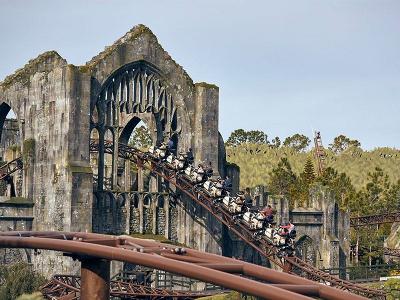 | 必玩 · [Universal Orlando Resort](https://blog.discoveruniversal.com/attractions/the-ultimate-guide-to-hagrids-magical-creatures-motorbike-adventure-at-universal-orlando-resort/) |
| **禁忌之旅／霍格沃茨城堡** 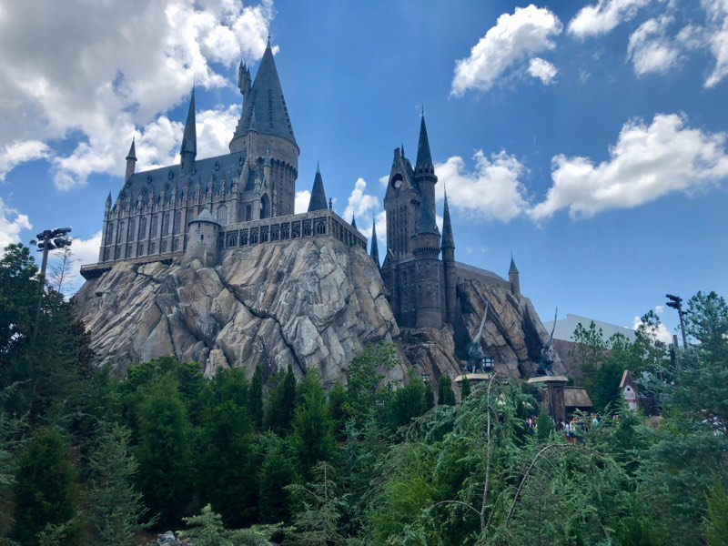 | 可选项目 · 拍照 · [Gregory Varnum / Wikimedia Commons](https://commons.wikimedia.org/wiki/File:Universal_Studios_Orlando_-_June_2018_(0211).jpg) · [CC BY-SA 4.0](https://creativecommons.org/licenses/by-sa/4.0/) · 缩小尺寸并压缩 |
| **迅猛龙过山车** 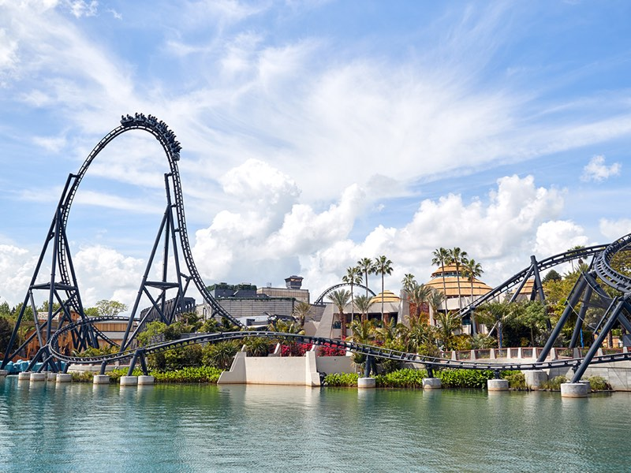 | 必玩 · [Universal Orlando Resort](https://blog.discoveruniversal.com/attractions/complete-guide-to-jurassic-world-velocicoaster-at-universals-islands-of-adventure/amp/) |
| **绿巨人过山车** 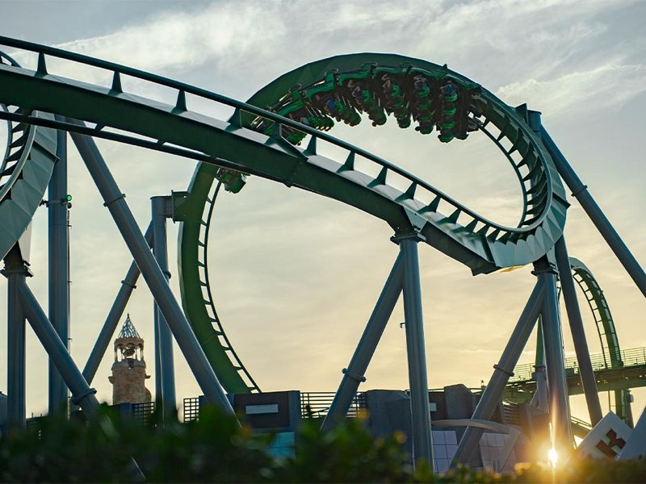 | 必玩 · [Universal Orlando Resort](https://blog.discoveruniversal.com/guides-and-tips/complete-guide-to-universal-islands-of-adventure/amp/) |
| **蜘蛛侠惊险历险** 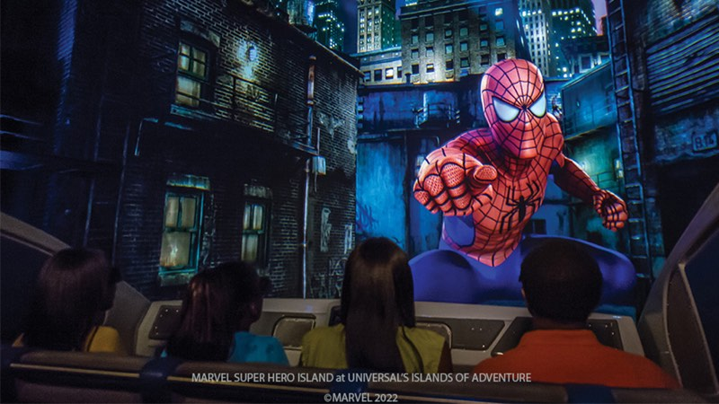 | 可选 · [Universal Orlando Resort](https://blog.discoveruniversal.com/attractions/the-complete-guide-to-the-amazing-adventures-of-spider-man/amp/) |
| **Seuss Landing 园景** 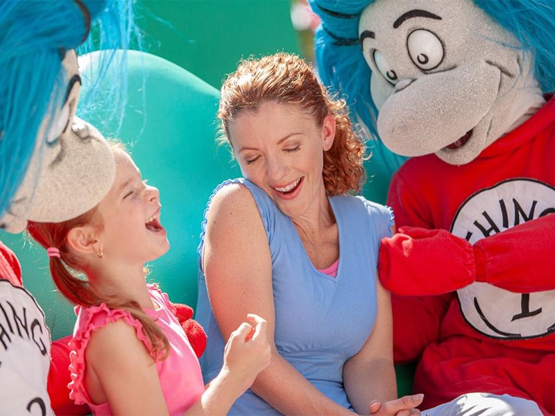 | 拍照 · [Universal Orlando Resort](https://blog.discoveruniversal.com/guides-and-tips/complete-guide-to-universal-islands-of-adventure/amp/) |
| **三把扫帚午餐** 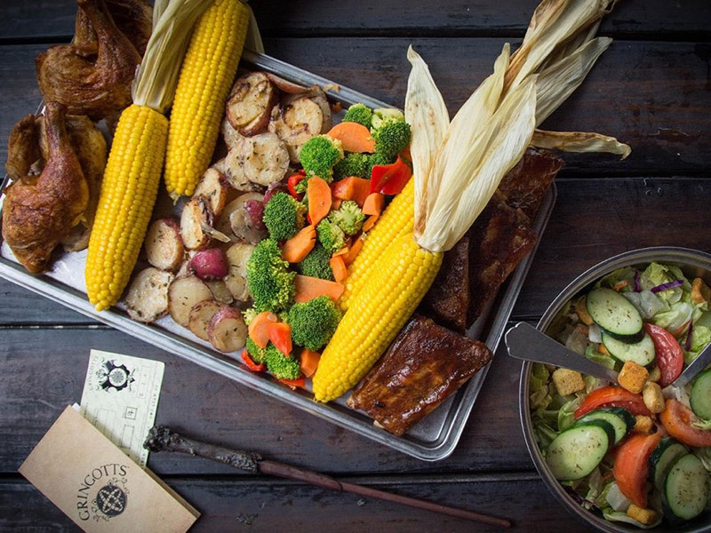 | 午餐参考 · [Universal Orlando Resort](https://blog.discoveruniversal.com/guides-and-tips/ultimate-guide-wizarding-world-harry-potter-universal-orlando-resort/amp/) |

<!-- project-photos:end -->

**当日排队：** [冒险岛实时队列](https://queue-times.com/en-US/parks/64/queue_times)。官方 App 优先；网页公布普通队等待，不是 Express 等待。

**路线思路：** 正门 → Hogsmeade 海格与城堡 → 午餐 → Jurassic 迅猛龙 → Marvel 绿巨人／蜘蛛侠 → 傍晚园景。  
**今日必须优先：海格、迅猛龙、绿巨人。** 其他项目按体力挑，不让附加项目吃掉拍照和坐下休息。

以下按正式开园前后安排；当天开关园时间尚未核实，不把示例时段当官方营业表。住民宿，不按酒店提前入园资格规划。

| 时段 | 安排 | Express／临场判断 |
| --- | --- | --- |
| 正式开园前约 60 分钟 | 到环球指定下客区，安检、经 CityWalk 步行入园 | 给下车到园门留 30–45 分钟；前晚很晚入住就不硬抢开门 |
| 开园后第一段 | **Hagrid’s 海格摩托** | 按普通队列预留约 60–120 分钟的规划空间，实际可能更久；未开放就先玩附近，不原地无限等 |
| 上午后段 | **Forbidden Journey 可选＋Hogsmeade／城堡拍照** | 如玩则用适用的 Express；拍照单独留 30–45 分钟 |
| 约 11:30–12:30 | **Three Broomsticks 午餐＋休息** | 坐下至少 45 分钟；若海格排队拖后，餐点跟着后移，不取消午餐 |
| 午餐后先散步 | 走到 Jurassic 区，喝水、拍园景 | 不刚吃饱就连续坐强刺激项目 |
| 下午第一段 | **VelociCoaster 迅猛龙** | 使用适用 Express；第一次满意且不想重刷，就把后面时间留园景 |
| 下午第二段 | **Hulk 绿巨人＋Spider-Man 可选** | 使用适用 Express；两项刺激项目之间穿插休息 |
| 约 16:00–17:00 | Port of Entry、Seuss Landing 或喜欢的区域拍照 | 留 30–45 分钟；控制折返，周日有跨园票还可回来 |
| 入夜后、关园前 | Hogsmeade 节日灯光／城堡外观；有精力再看海格等待情况 | 不把海格第一次留到关园前赌运行；是否二刷由体力和真实排队决定 |

**如果海格已显示很长等待：** 先确认三人是否愿意把约 2 小时交给它；不愿等就先完成附近项目，下午再查。周日跨园补刷是后备机会，不能保证届时更短或一定开放。

**午餐建议：Three Broomsticks 三把扫帚。** 位于 Hogsmeade，英式简餐与主题环境适合在这段路线吃午餐。按菜单选 Fish and Chips、Shepherd’s Pie 或其他个人主食；三人不必为了套餐硬点超量。[官方餐厅与菜单](https://www.universalorlando.com/web/en/us/things-to-do/dining/three-broomsticks)

**晚餐：** 关园和打车时间确定后就近解决，或回民宿吃；不另订一个必须准点赶到的远餐厅。12 月不主动加容易湿透的水上项目。

### 12/6 周日｜Studios 精选半日＋冒险岛补刷

<!-- project-photos:start -->
#### 当天项目图片

图片对应当天行程；“可选”和 A／B 路线仍按原计划取舍。图片为项目与景观参考，不代表当天运营、天气或观看位置。

| 项目与图片 | 行程定位／图片来源 |
| --- | --- |
| **古灵阁逃脱** 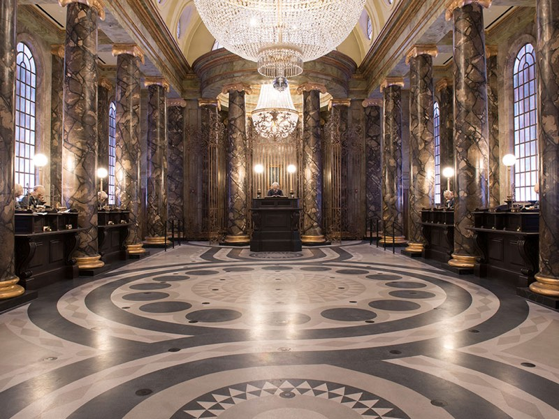 | 优先 · [Universal Orlando Resort](https://blog.discoveruniversal.com/guides-and-tips/10-things-you-have-to-do-at-universal-studios/) |
| **对角巷街景** 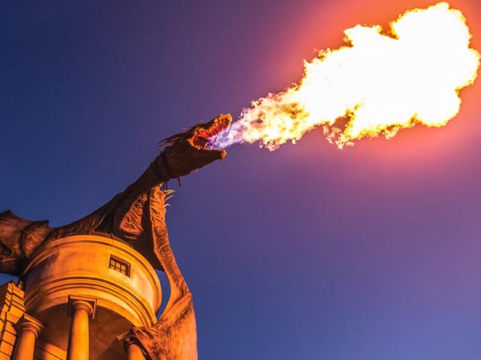 | 拍照 · [Universal Orlando Resort](https://blog.discoveruniversal.com/guides-and-tips/the-ultimate-thrill-seekers-guide-to-universal-orlando-resort/) |
| **木乃伊复仇** 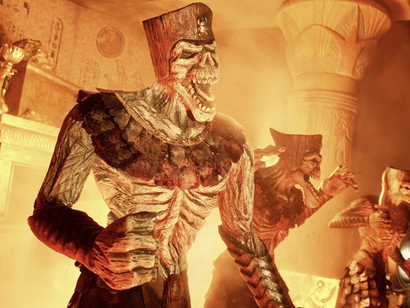 | 优先 · [Universal Orlando Resort](https://blog.discoveruniversal.com/guides-and-tips/10-things-you-have-to-do-at-universal-studios/) |
| **Bourne 特技秀** 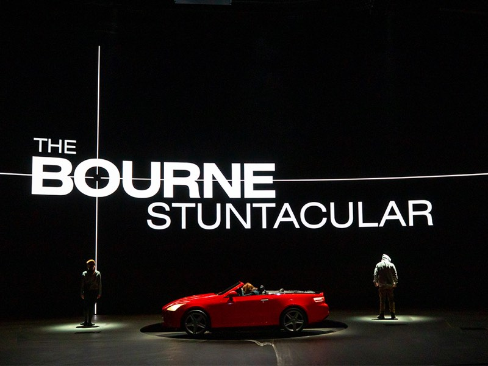 | 可选表演 · [Universal Orlando Resort](https://blog.discoveruniversal.com/guides-and-tips/10-things-you-have-to-do-at-universal-studios/) |
| **破釜酒吧午餐** 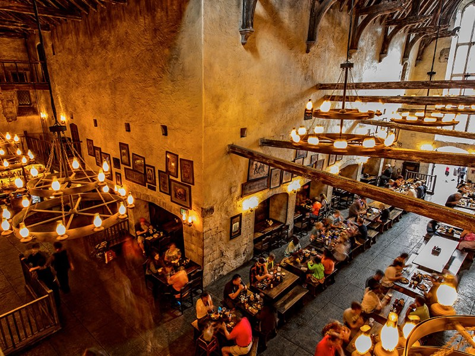 | 午餐 · [Universal Orlando Resort](https://blog.discoveruniversal.com/guides-and-tips/ultimate-guide-wizarding-world-harry-potter-universal-orlando-resort/amp/) |
| **霍格沃茨特快列车** 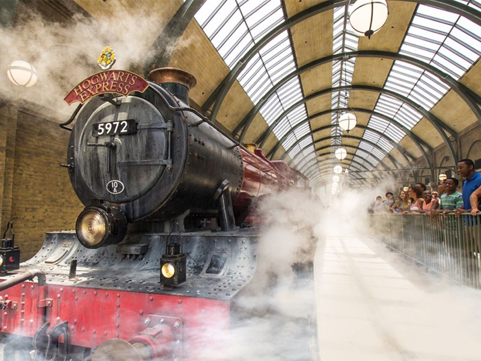 | 跨园可选 · [Universal Orlando Resort](https://blog.discoveruniversal.com/guides-and-tips/ultimate-guide-wizarding-world-harry-potter-universal-orlando-resort/amp/) |

<!-- project-photos:end -->

**当日排队：** [Studios 实时队列](https://queue-times.com/en-US/parks/65/queue_times) · [冒险岛实时队列](https://queue-times.com/en-US/parks/64/queue_times)。跨园前先查目标运行情况。

**主线：Studios 看对角巷与两三个代表体验；下午把额外时间交给更喜欢的冒险岛。**  
**跨园前提：Park-to-Park 门票。** 没有跨园权限时，按本节末尾的一园版执行。

| 时段 | 安排 | 为什么这样排 |
| --- | --- | --- |
| 正式开园前后 | 到环球下客区，进入 **Universal Studios Florida** | 今天有跨园安排，不采用原版 10:00 才到的晚出门思路 |
| 开园后第一段 | **Gringotts 古灵阁＋对角巷** | ride 用适用 Express；街景与店铺拍照留 45–60 分钟 |
| 上午后段 | **Revenge of the Mummy** | 作为 Studios 第二个主项目；不再排一串相似模拟器 |
| 午间前后 | **The Bourne Stuntacular 可选** | 有合适场次就看；若需多等一小时，先比较是否更想去冒险岛 |
| 约 12:00–13:00 | **Leaky Cauldron 午餐**，或依场次移动 | 至少坐下 45 分钟；午餐地点和演出顺序可交换，留园内步行时间 |
| 约 13:00–14:00 | **跨园一次：Studios → 冒险岛** | 想坐 Hogwarts Express 就从伦敦区乘车；排队长也可出园经 CityWalk 步行。跨园整体留约 45–60 分钟 |
| 下午前段 | 补周六遗漏的 **海格／迅猛龙／绿巨人** | 优先补没完成的，再考虑重刷；海格若要长排，这个下午就围绕它安排 |
| 下午后段 | 喜欢的园区再拍照，或用合适票种补一个项目 | 当日 Express 覆盖哪一园就按该园权限使用；不是所有票都能多次走快队 |
| 约 17:30–18:30 | 视两园当天开放时间结束，打车回民宿 | 目标是今晚早点休息，为 Epic 留状态，不要求留到关园 |

**Studios 项目优先级：古灵阁 → 木乃伊 → Bourne；其余随缘。** 表演具体场次以 App 为准；假日巡游若与你们更想重刷的冒险岛冲突，本版优先冒险岛，不来回跨园追巡游。

**午餐建议：Leaky Cauldron 破釜酒吧。** 位于对角巷，选英式热餐或轻一些的主食；如果先看 Bourne，再回这里会有步行折返，要把它计入时间，不能按“演出散场马上入座”安排。[官方餐厅与菜单](https://www.universalorlando.com/web/en/us/things-to-do/dining/leaky-cauldron)

**Hogwarts Express：** 仅连接旧双园，不连接 Epic；乘车仍需同日两园入园权限。[官方列车说明](https://www.universalorlando.com/web/en/us/things-to-do/rides-attractions/hogwarts-express?intsrch=new)

**如果是每天一园票：** 周日整天留 Studios：上午古灵阁、对角巷；午餐后木乃伊／Bourne，下午电影街景与室内休息，傍晚看能衔接的假日巡游。周六必须优先做完三个冒险岛核心，不把补刷当作确定存在。

### 12/7 周一｜Epic：五个核心 ride＋两场表演＋夜景

<!-- project-photos:start -->
#### 当天项目图片

图片对应当天行程；“可选”和 A／B 路线仍按原计划取舍。图片为项目与景观参考，不代表当天运营、天气或观看位置。

| 项目与图片 | 行程定位／图片来源 |
| --- | --- |
| **魔法部之战** 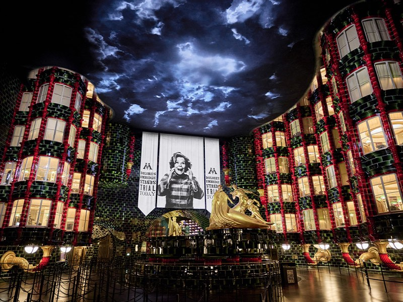 | 必玩 · [Universal Orlando Resort](https://blog.discoveruniversal.com/guides-and-tips/complete-guide-to-universal-epic-universe/) |
| **Le Cirque Arcanus** 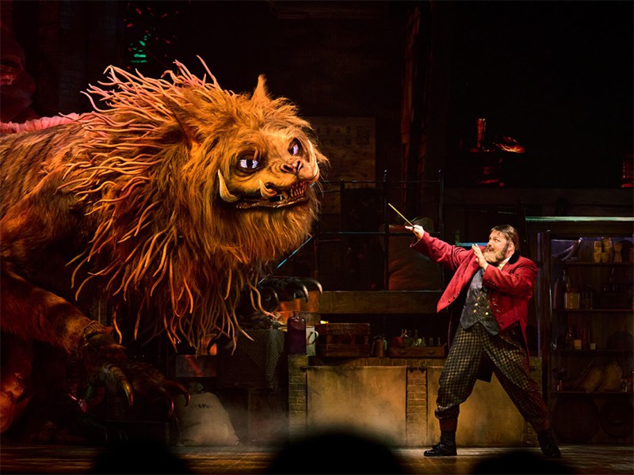 | 推荐表演 · [Universal Orlando Resort](https://blog.discoveruniversal.com/guides-and-tips/ultimate-guide-wizarding-world-harry-potter-universal-orlando-resort/amp/) |
| **驯龙高手 Wing Gliders** 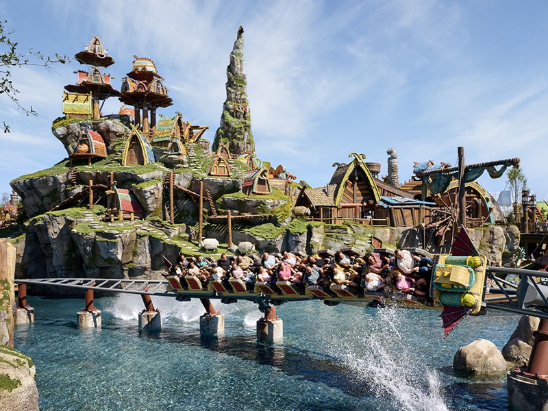 | 必玩 · [Universal Orlando Resort](https://blog.discoveruniversal.com/guides-and-tips/complete-guide-to-universal-epic-universe/) |
| **The Untrainable Dragon** 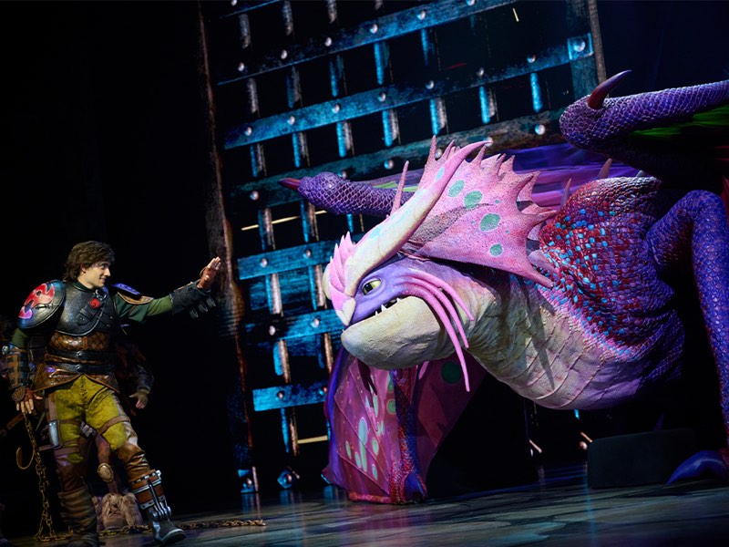 | 推荐表演 · [Universal Orlando Resort](https://blog.discoveruniversal.com/guides-and-tips/complete-guide-to-universal-epic-universe/) |
| **咚奇刚 Mine-Cart Madness** 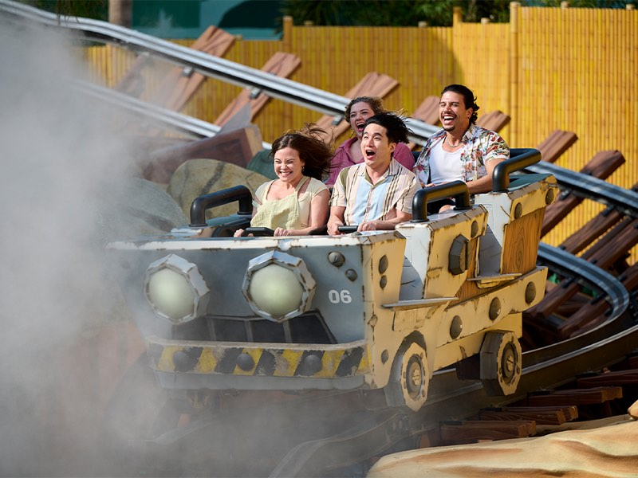 | 必玩 · [Universal Orlando Resort](https://blog.discoveruniversal.com/guides-and-tips/complete-guide-to-universal-epic-universe/) |
| **Stardust Racers** 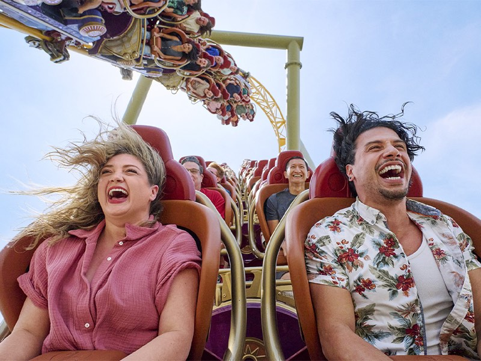 | 必玩 · [Universal Orlando Resort](https://blog.discoveruniversal.com/guides-and-tips/complete-guide-to-universal-epic-universe/) |
| **狼人诅咒** 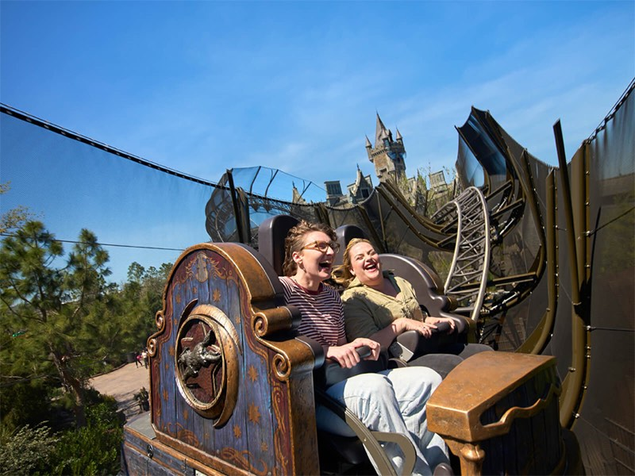 | 室外核心 · [Universal Orlando Resort](https://blog.discoveruniversal.com/guides-and-tips/guide-to-dark-universe-in-universal-epic-universe/) |
| **Monsters Unchained** 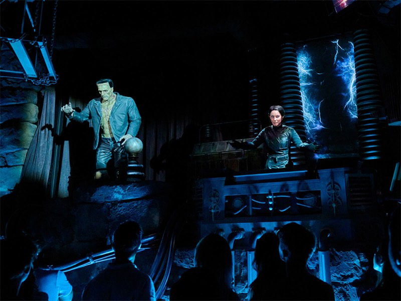 | 有余量再加 · [Universal Orlando Resort](https://blog.discoveruniversal.com/guides-and-tips/guide-to-dark-universe-in-universal-epic-universe/) |
| **Celestial Park 园景** 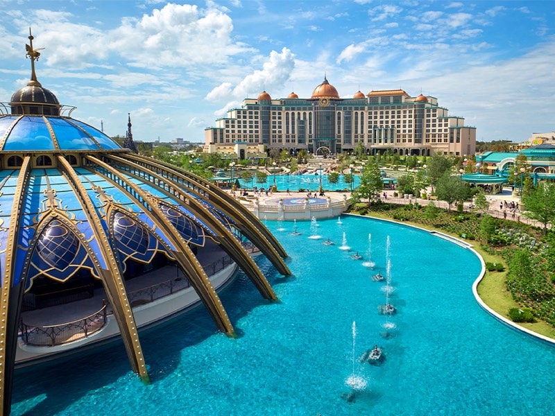 | 拍照 · [Universal Orlando Resort](https://blog.discoveruniversal.com/guides-and-tips/complete-guide-to-universal-epic-universe/) |
| **Mead Hall 午餐** 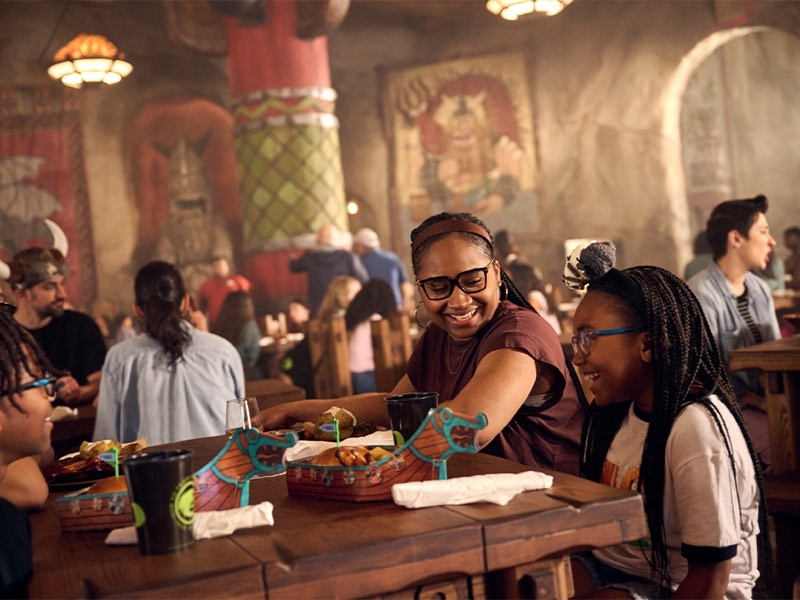 | 午餐 · [Universal Orlando Resort](https://blog.discoveruniversal.com/guides-and-tips/complete-guide-to-universal-epic-universe/) |

<!-- project-photos:end -->

**当日排队：** [Epic 实时队列](https://queue-times.com/en-US/parks/334/queue_times)。表演场次、Express 与临时停运以官方 App／现场为准。

**今天按购买 Epic Express 来规划。** 核心清单为 **魔法部、Wing Gliders、咚奇刚、Stardust、狼人＋两场表演**；Monsters Unchained 为优先补充。若“黑暗世界 ride”实际指室内项目，就将 Monsters 与狼人互换优先级。

**路线思路：魔法部区域 → 伯克岛 → 任天堂区域 → Celestial Park → Dark Universe → 中央园区夜景。** 这不是强制单向路线；两场表演场次、天气与项目运行可能需要交换分区顺序。

#### 开园先做这三件事

1. 在 App 查 **Le Cirque Arcanus** 和 **The Untrainable Dragon** 当天场次，各选一个可行时段，避开把两场都留在最后。
2. 确认魔法部、咚奇刚、Stardust 等目标是否开放及 Express 当前是否接收；项目停运先换附近活动，不反复横穿全园。
3. 三人确认黑暗世界想玩室外狼人还是室内 Monsters；若都想玩，把其他附加项目删掉，为两项留时间。

#### 当天执行表

| 阶段 | 安排 | 给自己留多久 |
| --- | --- | --- |
| 开园前 | 到 **Epic 独立园区的指定下客点**，安检入园 | 正式开园前约 45–60 分钟抵达；不按酒店提前入园规划 |
| 上午第一站：魔法部 | **Battle at the Ministry** → 巴黎街景 → **Le Cirque Arcanus** | 总计预留约 2–2.5 小时，包含行走、Express 等待、演出提前到场与拍照；表演场次不合适则交换与伯克岛顺序 |
| 午前至午后：伯克岛 | **Hiccup’s Wing Gliders** → **Mead Hall 午餐** → **The Untrainable Dragon** | 约 2–2.5 小时；午餐坐下 45–60 分钟，伯克岛拍照另留约 20 分钟；演出时间优先，饭前饭后可调 |
| 下午：任天堂区域 | **Mine-Cart Madness 咚奇刚** → 园区拍照 | 约 60–90 分钟；目标是咚奇刚，不要求同时完成 Mario Kart、Yoshi 和所有互动 |
| 下午、天黑前 | **Stardust Racers** | 含步行、寄物与 Express 等待预留约 30–60 分钟；若天气有变，提前做，不把首次体验押在最后 |
| 约 16:30–17:30、依前面进度 | 一段夕阳／蓝调园景拍照＋饮料休息 | 保留 30–45 分钟即可，不强求此时回每个分区拍一遍；表演更早结束就更从容 |
| 傍晚至晚上：Dark Universe | **Curse of the Werewolf**；有余量再加 **Monsters Unchained** | 单项预留约 30–60 分钟；若两项都玩，预留 60–90 分钟或更多，并相应减少其他停留 |
| 最后一段 | 轻晚餐、Celestial Park 灯光／喷泉与夜景 | 留 45–60 分钟；按真实关园时间收尾，不默认一定有特定烟花／夜间秀 |

**这是一份整天的目标清单，不是完成保证。** Express 不等于零等待；五个 ride、两场表演、餐饮、移动和拍照都需要时间。12/7 的准确营业时间与场次尚未核实：若当日开放时长较短或核心项目停运，按下方优先级缩减，不能靠取消所有休息来强行完成。

#### 时间不够怎么删

1. 先删 Mario Kart、Yoshi、角色长队和额外商店购物；它们本来就不是当天必做。
2. 再删 Monsters／狼人中非核心的那一项；保留三人确认最想玩的黑暗世界 ride。
3. 把纯拍照总时间收束到 **约 75–90 分钟**，分散在巴黎、伯克岛、任天堂和中央园区，不完全取消照片。
4. Stardust 若已坐过一次，夜间二刷只作为普通排队可选；不要把同一张普通 Express 当作无限使用。
5. 两场表演既然是你们明确想看的，就提前安排；不要为了补一个附加 ride 错过最后可行场次。

**当日用餐：Mead Hall。** 位于伯克岛，适合把午餐、主题环境和室内坐下休息合并。按当天菜单选肉类、鱼类、三明治等，三人不必都点重餐；晚餐在所在分区找简餐，控制约 30–45 分钟，不订另一个必须跨园区赶到的正式晚餐。[Mead Hall 官方介绍](https://www.universalorlando.com/web/en/us/things-to-do/dining/mead-hall)

**拍照怎么分配：** 巴黎街景约 20 分钟、伯克岛约 20 分钟、任天堂约 15–20 分钟、Celestial Park 蓝调／夜景约 30 分钟。拍摄和休息穿插进行，不另带复杂换装；三人合照先拍，再轮流单人。

**现场信息来源：** [Epic 官方指南](https://blog.discoveruniversal.com/guides-and-tips/complete-guide-to-universal-epic-universe/) · [Express 覆盖与条款](https://www.universalorlando.com/web/en/us/tickets-packages/express-passes) · [魔法部表演官方页](https://www.universalorlando.com/web/en/us/things-to-do/shows/le-cirque-arcanus)

### 12/8 周二｜EPCOT：料理鼠王＋银河护卫队＋提前找位看烟花

<!-- project-photos:start -->
#### 当天项目图片

图片对应当天行程；“可选”和 A／B 路线仍按原计划取舍。图片为项目与景观参考，不代表当天运营、天气或观看位置。

| 项目与图片 | 行程定位／图片来源 |
| --- | --- |
| **料理鼠王** 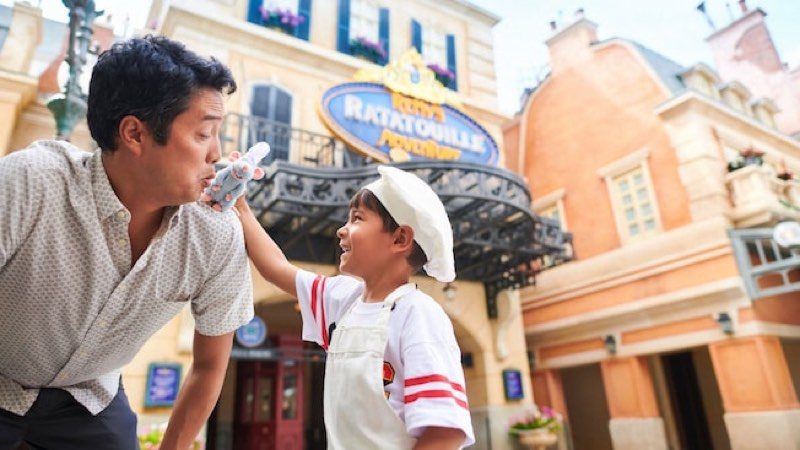 | 必玩 · [Disney](https://disneyworld.disney.go.com/attractions/epcot/remys-ratatouille-adventure/) |
| **银河护卫队 Cosmic Rewind** 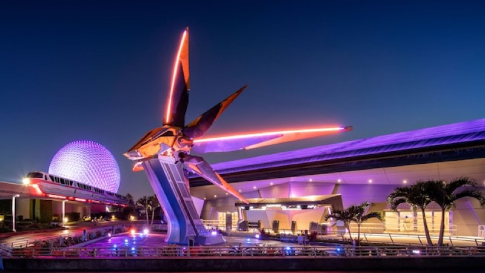 | 必玩 · [Disney](https://disneyworld.disney.go.com/attractions/epcot/guardians-of-the-galaxy-cosmic-rewind/) |
| **Soarin’ Across America** 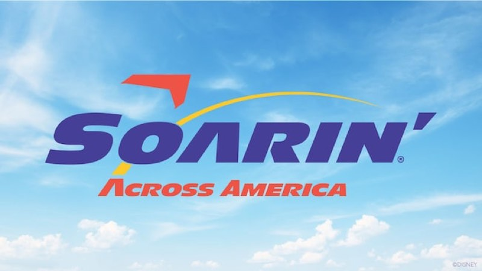 | 推荐 · 官方主题图 · [Disney](https://disneyworld.disney.go.com/attractions/epcot/soarin-across-america/) |
| **温室圣诞灯光船游** 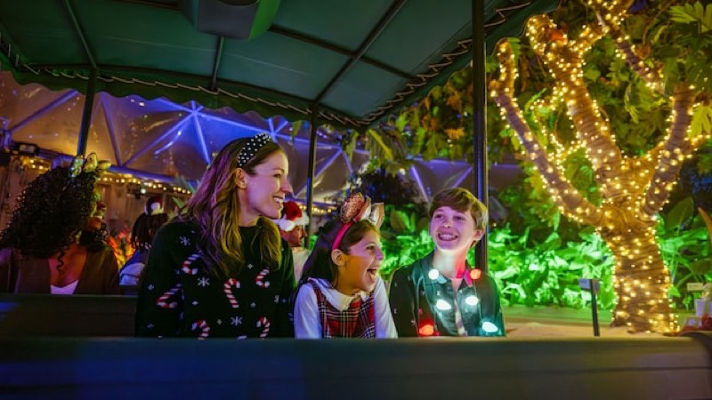 | 推荐 · [Disney](https://disneyworld.disney.go.com/attractions/epcot/glimmering-greenhouses/) |
| **Moana 水之旅** 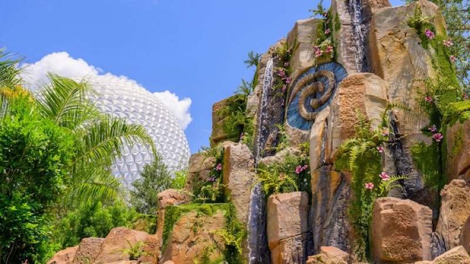 | 顺路慢走 · [Disney](https://disneyworld.disney.go.com/attractions/epcot/journey-of-water/) |
| **Spaceship Earth** 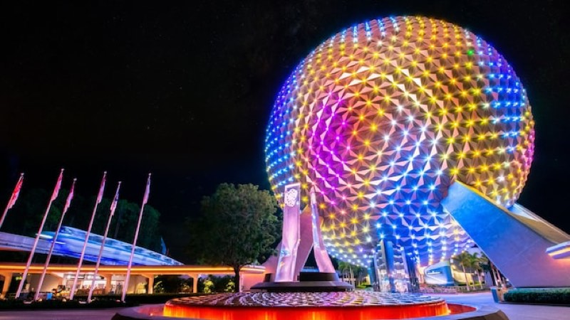 | 休息型备选 · [Disney](https://disneyworld.disney.go.com/attractions/epcot/spaceship-earth/) |
| **Luminous 烟花**  | 提前找位 · [Disney](https://disneyworld.disney.go.com/entertainment/epcot/luminous-the-symphony-us/) |
| **Candlelight Processional** 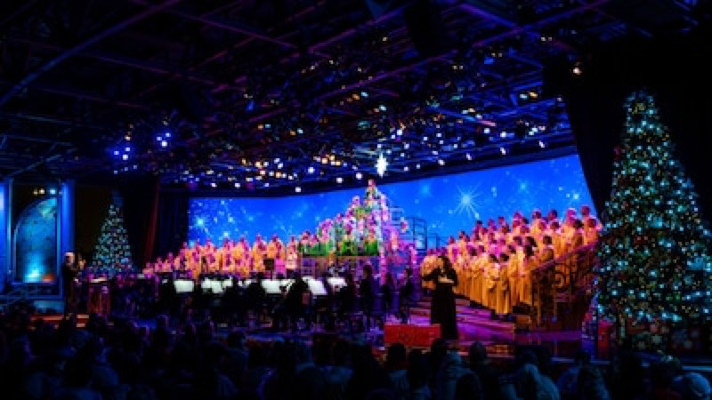 | 可选表演 · [Disney](https://disneyworld.disney.go.com/events-tours/epcot/holiday-festival-entertainment/) |
| **Holiday Storytellers**  | 路过短看 · [Disney](https://disneyworld.disney.go.com/events-tours/epcot/holiday-festival-entertainment/) |

<!-- project-photos:end -->

**当日排队：** [EPCOT 实时队列](https://queue-times.com/en-US/parks/5/queue_times)。LL 回场窗口与烟花开演时间看 My Disney Experience。

**今天三个不可挤掉的重点：Remy’s Ratatouille Adventure 料理鼠王、Guardians of the Galaxy: Cosmic Rewind 银河护卫队过山车、Luminous 烟花的完整观赏时间。** 其他体验围绕它们安排，不为了加项目到最后一刻才去湖边。

**推荐附加组合：Soarin’＋Living with the Land 圣诞灯光版；Moana 水景步道和 Spaceship Earth 按顺路与体力二选一。** 世界馆以法国为核心，再挑两处拍照，不追一圈全逛。

#### 核心项目与 Lightning Lane：先把两项落实

环球 Express 不能在 EPCOT 使用。迪士尼当前将 **Guardians 列为 Single Pass**；**Remy 列为 Multi Pass 第一组**，与 Frozen、Test Track 同组，预选不能把这三项都选上。想给拍照和烟花留时间，可比较 **Guardians Single Pass＋EPCOT Multi Pass** 的三人总价；这是建议，尚未决定或购买。[迪士尼官方 Lightning Lane 规则](https://disneyworld.disney.go.com/lightning-lane-passes/)

| 项目 | 优先程度 | 建议执行 |
| --- | --- | --- |
| **Guardians of the Galaxy: Cosmic Rewind** | 必玩 | 若购买 Single Pass，优先选上午可行时段；预留约 45–60 分钟涵盖进场、前秀与乘坐，不按几分钟 ride 时长安排整站 |
| **Remy’s Ratatouille Adventure** | 必玩 | 若购买 Multi Pass，把第一组优先给 Remy，争取约 13:00–14:30 的可行时段，和法国馆拍照衔接 |
| **Soarin’ Across America** | 最推荐附加 ride | 可作为 Multi Pass 其他预选之一，争取傍晚；若没合适时段就换顺序，不跨全园赶一个附加项目 |
| **Living with the Land – Glimmering Greenhouses** | 最推荐季节体验 | 尽量安排天黑后，和 Soarin’ 同在 The Land 一次完成；具体预约名称以 App 为准 |

**购买窗口提醒：** 按“住民宿＋12/8 单日日期票”的当前安排，普通非指定酒店住客可提前 3 天、东部时间 07:00 起购买，故目标是 **12/5 周六 07:00 EST**；若票种或住宿资格改变，按 App 重新确认。那天也是冒险岛日，建议一人出门前统一查看三人的同行关联、可选项目和重叠时段，不要等到开园后才处理。时段与库存不保证。[官方购买窗口](https://disneyworld.disney.go.com/lightning-lane-passes/)

**如果不买 Lightning Lane，或买不到 Remy：** 先看 App 当日入场／排队方式。能普通排队时，正式开园后优先处理 Remy 与 Guardians 中尚未落实的一项，接受上午可能主要花在两条队上；相应删掉附加项目。住民宿不按 Early Entry 资格规划，也不假设正门入园能抢在后门早入园人流之前。**不要把两个必玩都留到烟花前赌短队。**

#### 其他活动：网上口碑＋你们偏好的取舍

下表是综合攻略评价后，按你们“玩两个重点，也看风景拍照”的需求筛选，**不是全网统一排名**。旧攻略对 Soarin’ 和普通版 Living with the Land 的评价，只作体验类型参考；当季内容另以官方核实。

| 推荐顺序 | 活动 | 为什么推荐给你们 | 本版怎么取舍 |
| --- | --- | --- | --- |
| **1：优先加** | **Soarin’ Across America** | TouringPlans 游客评价中，Soarin’ 属于高口碑项目；飞行模拟看景很符合你们偏好。官方目前是 Across America 版本，别按旧版 Around the World 的具体画面期待 | 与温室船同在 The Land，尽量连着做；等太久且无预约时可删，不能影响两个核心与烟花 |
| **2：优先加** | **Living with the Land – Glimmering Greenhouses** | 缓和船游＋温室圣诞灯光，适合连玩几天乐园后的休息；Disney Tourist Blog 对其节日版评价很积极 | 官方确认 11/27–12/30 提供节日版；傍晚后更能看出灯光，留约 30–45 分钟含等候 |
| **3：顺路就做** | **Journey of Water, Inspired by Moana** | 攻略对它的水景和互动步道评价不错，适合拍照和慢走；不必把水互动全做一遍 | 留 15–25 分钟，尽量走不易淋湿的路径，冷天减少玩水 |
| **4：休息型备选** | **Spaceship Earth** | 经典缓慢暗骑，适合坐着恢复；球体外观也是 EPCOT 代表照片 | 普通队短就做，长队就只拍外观；晚上散场时不额外补排 |
| **5：喜欢圣诞演出才替换** | **Candlelight Processional** | 合唱、乐队与圣诞叙事更重氛围，适合愿意坐下听现场音乐的人 | 需要按场次加上入场等候；用它替换一段附加活动，不在现有路线外硬加。普通餐厅订位不等于演出保留座位 |
| **6：路过短看** | **Holiday Storytellers／节日小吃** | 比追更多 ride 更能感受世界馆节日气氛 | 挑一段短演出、两三样分享的小吃即可，不每个国家逐一打卡 |

口碑来源：[TouringPlans 项目评价](https://touringplans.com/epcot/attractions/our-ratings)、[Disney Tourist Blog 的 EPCOT 体验评价](https://www.disneytouristblog.com/best-epcot-attractions-ride-guide/)。当季内容：[Soarin’ Across America 官方页](https://disneyworld.disney.go.com/attractions/epcot/soarin-across-america/)、[Glimmering Greenhouses 官方页](https://disneyworld.disney.go.com/attractions/epcot/glimmering-greenhouses/)、[节日活动官方页](https://disneyworld.disney.go.com/events-tours/epcot/holiday-festival/)。

**Frozen／Test Track：** 都是可考虑的热门，但你们已经连玩环球，今天不再列为必须。特别喜欢 Frozen 的场景或想体验 Test Track，再用它替换 Soarin’ 等附加项目。Mission: SPACE、Figment 等不专门绕路。这样保留三人坐下休息与拍照的余量。

#### 当天执行时间表

**路线思路：正门 → 前区银河护卫队 → 午餐 → 法国馆料理鼠王与拍照 → 精选世界馆 → 经英国／加拿大回 The Land → Soarin’＋温室灯光 → 晚餐 → 湖区北侧烟花。** 这条路线选择回到前区看季节灯光，并不绕湖一整圈；法国、摩洛哥、日本最多挑两三处，走累就在法国折返。

下列钟点是目标安排，不是已确认的 12/8 营业或预约时间。**两项核心按实际拿到的时段调整；晚间以烟花实际开始时间 T 为硬边界。**

| 时间／阶段 | 具体安排 | 给三人留什么时间 |
| --- | --- | --- |
| 正式开园前约 45–60 分钟 | 到 EPCOT 正门指定下客区，安检、步行入园 | 不按酒店提前入园资格；门口球体先拍少量照片，长拍放后面 |
| 上午、按预约窗口 | **Guardians 银河护卫队** | 核心优先，出场后喝水、坐一会儿，不立即追第二个强刺激项目 |
| 上午剩余空档 | **Spaceship Earth 或 Moana 二选一** | 没有合适空档就删，不影响 Guardians 或 Remy 的时间 |
| 约 11:30–12:20 | **Connections Eatery 午餐** | 室内坐下约 45–50 分钟；不要为了拍照只吃一份边走边啃的点心 |
| 约 12:20–13:00 | 往法国馆移动 | 为跨区步行、卫生间和拍照留缓冲；可以经加拿大／英国方向走 |
| 约 13:00–14:30、按预约窗口 | **Remy 料理鼠王＋法国馆** | ride 和街景分开算，法国街景、喷泉、店铺细节至少留 30 分钟 |
| 约 14:30–16:00 | 世界馆精选＋一段坐下休息 | 法国／摩洛哥／日本按喜好选，别逛到湖另一端才发现要回 The Land；小吃三人分享 |
| 约 16:00–17:00 | 经英国／加拿大方向返回前区，沿途拍照 | 今天允许这段有目的的折返，是为了晚上温室灯光；累了就从法国直接回，不再去日本 |
| 约 17:00–18:30 | **Soarin’＋Glimmering Greenhouses** | 同一栋 The Land 内连续完成；普通队太长时只选一个，灯光船优先。若预约只能在白天，接受白天体验，别为夜景重复长排 |
| 约 18:30–19:20 | **Connections Eatery 晚餐**，或当时顺路的营业简餐 | 给点餐和入座留余量；最晚在 T−90 分钟前完成主要用餐，不以排队摊位作为唯一晚餐 |
| **T−90 分钟** | 结束其他活动，上厕所、补水、带好外套，往湖边走 | 从 The Land／餐厅到湖畔另留约 15–20 分钟；不再去世界馆另一端 |
| **T−75 至 T−60 分钟** | **找烟花观看位置** | 看清湖面低处、树冠和围栏，先确认普通游客是否可进入；必要时就近换备选 |
| **T−60 至 T** | **基本定点等候** | 三人一起留足空间，不靠放包替整组长期占位；提前完成买吃的和卫生间 |
| **T 至 T＋30 分钟** | **完整看 Luminous 烟花／喷泉／音乐** | 用 30 分钟观赏预算覆盖开演与结束缓冲，不等于断言表演本身正好 30 分钟 |
| **T＋30 至 T＋60 分钟起** | 随人流向正门离园、去指定上车点 | 若路过球体可短拍，别逆人流找角度；散场打车可能还需额外等候 |

**例子只用于换算：** 如果当天 App 显示 **21:00** 开演，那么 **19:30 结束其他任务并准备往湖区走、19:45 开始选位、20:00 基本定点**；若显示 21:30，以上时间整体顺延半小时。官网普通页面当前显示的时间不代表已经核实 12/8 的节目表。[Luminous 官方页](https://disneyworld.disney.go.com/entertainment/epcot/luminous-the-symphony-us/)

#### 烟花看哪里：首选视野与返程都方便的位置

**首选：World Showcase Plaza 湖畔的开放公共区域，靠 Port of Entry 与 Disney Traders 两间商店之间的湖区入口方向。** 这里是到湖边看，不是站在 EPCOT 大门或球体下远看；选择能同时看见湖中央低处和天空的位置。

| 选择 | 为什么选／怎么判断 | 到场后怎么做 |
| --- | --- | --- |
| **A：World Showcase Plaza 开放湖畔** | 攻略常推荐的正面角度，结束后向主入口离园相对直接；与你们打车返程衔接更好 | T−75 分钟开始看位，T−60 分钟尽量定下来；若有封绳、私人活动或专用区域，改附近公共段，不以提前到场保证前排 |
| **B：加拿大／英国方向就近开放湖畔** | A 不合适时不绕湖，沿同一侧找清楚看到中央水面的位置 | 看树、摊位、建筑和岸线是否遮住低处；不把餐厅露台当作免费公共观赏位 |
| **C：日本至美国馆方向的开放湖畔** | 也是攻略推荐区域；但对正门打车返程更远 | 仅当你们已决定晚餐／晚间活动留在湖对面时选它；不从 A 特意绕过去“找绝对最好位置” |

选位参考：[Undercover Tourist 的 Luminous 观赏指南](https://www.undercovertourist.com/blog/epcot-fireworks/)、[Disney Tourist Blog 的风向与遮挡提醒](https://www.disneytouristblog.com/best-epcot-fireworks-viewing-spots/)。**提前 75 分钟找、60 分钟定点是针对你们重视烟花视野而留的规划余量，不是官方要求，也不能保证第一排。**

**现场检查四件事：** 看得到中央湖面低处；前方和头顶没有明显遮挡；风若把烟吹向这里，趁早换就近位置；站位不占通道、演出封闭区或无障碍专用区域。别只想着能看到高空烟花，就忽略喷泉与低处效果。看完后可以沿正门方向慢慢走，不为抢一辆车奔跑。

#### 当天餐饮与拍照

| 用餐 | 推荐地点与点法 | 为什么这样安排 |
| --- | --- | --- |
| **午餐首选** | **Connections Eatery**：汉堡、鸡肉沙拉、披萨等按当日菜单选；目标 11:30 左右，坐下 45–50 分钟 | 在前区，先完成银河护卫队再吃，之后往法国馆走。[官方菜单与餐厅](https://disneyworld.disney.go.com/dining/epcot/connections-eatery/) |
| **午餐备选** | **Sunshine Seasons**：若午前就在 The Land，可选正餐和沙拉，吃完再去法国 | 官网说明 **16:00 后以 grab-and-go 为主**，因此不把它当晚上一定有完整热餐的保证。[官方说明](https://disneyworld.disney.go.com/dining/epcot/sunshine-seasons/) |
| **法国馆加餐** | **Les Halles Boulangerie-Patisserie**：法棍三明治、汤或甜点，三人分享一两样即可 | 与 Remy 同一区；座位不保证。它是法式面包甜点店，别和专门卖可丽饼的店混为一谈。[官方介绍](https://disneyworld.disney.go.com/dining/epcot/les-halles-boulangerie-patisserie/) |
| **晚餐** | **优先回 Connections Eatery**，或选你们所在区域当时营业的简餐；用 App 看菜单和下单窗口 | 先解决正餐再看烟花；T−90 分钟前吃好，节日小吃可作加餐，不因排网红摊错过选位 |

**拍照预算：** 法国馆约 30 分钟；摩洛哥／日本等选中的世界馆约 20–30 分钟；前区球体／Moana／夜间灯光合计约 20–30 分钟。烟花可拍一小段视频或几张合照，其余时间留给完整观看；不要把表演全程变成调手机参数。

#### 时间不足时按这个顺序删

1. 先删角色长队、全世界馆绕圈、额外购物和重复小吃排队。
2. 再删 Spaceship Earth／Moana 中没做的一项，以及 Frozen、Test Track 等附加项目。
3. Soarin’ 和温室灯光船若普通队都很长，只保留更想看的一个；不影响料理鼠王和银河护卫队。
4. **不砍烟花找位时间来换最后一个 ride。** 如果核心预约或项目延误，只能删附加活动；烟花 T−90 分钟开始进入收尾逻辑。

**临近复核：** 查 12/8 两个核心的入场方式、LL 产品和可订窗口、Soarin’ 与温室灯光版开放情况、Candlelight 场次，以及 Luminous 当天时间。打车仍从 EPCOT 正门指定上车区返程；不把世界馆后门当作随时可直达的打车口。

### 周三到周五详细版｜怎么用这三天

**我更建议的组合：周三 Silver Springs＋Ocala 午餐，周四 King’s Landing＋Mount Dora 湖边半日，周五按体力选 Sarasota 或 Winter Park。** 每天最多一段水上活动；小镇短逛可以随时砍掉。

本节参考 [Florida Rambler 的 Silver Springs 划船攻略](https://www.floridarambler.com/kayaking-in-florida/silver-springs-kayaking/)、[Simply Wander 的 King’s Landing 游记](https://justsimplywander.com/kings-landing-florida/)和 [Sarasota 旅游局的 Ringling 参观指南](https://www.visitsarasota.com/article/starters-guide-ringling)，再用景点、餐厅官网核对路线、营业时间和菜单。以下推荐顺序与停留时长是结合你们三人的偏好重新安排的；没有查询实时空位。

**共同约定：** 车程均为区域级规划估计，未按民宿门牌或实时交通计算。餐费预算以美元／人表示，是点餐预算，未含税、小费与酒水。营业时间按 2026/11/15 查到的常规信息填写，出发前再次复核。

### 12/9 周三｜Silver Springs 清泉 kayak → Ocala 老城午餐

<!-- project-photos:start -->
#### 当天项目图片

图片对应当天行程；“可选”和 A／B 路线仍按原计划取舍。图片为项目与景观参考，不代表当天运营、天气或观看位置。

| 项目与图片 | 行程定位／图片来源 |
| --- | --- |
| **Silver Springs 短线 kayak** 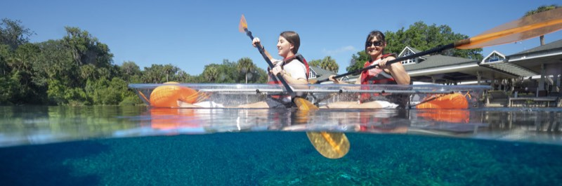 | 当天主线 · [Silver Springs State Park](https://silversprings.com/plan-your-day/paddling/) |
| **Ocala 老城** 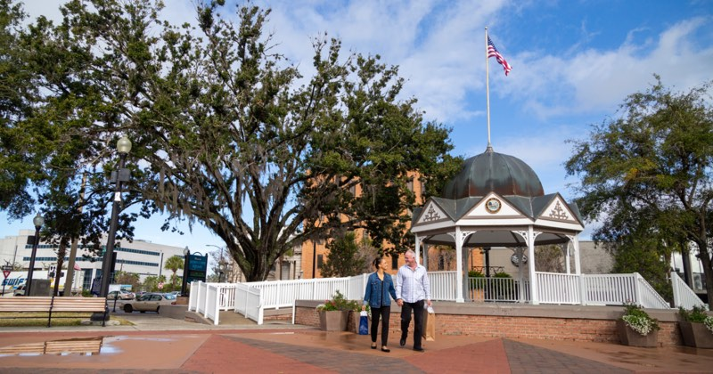 | 可选短逛 · [Ocala / Marion County](https://www.ocalamarion.com/blog/explore-historic-downtown-ocala/) |

<!-- project-photos:end -->

**今天看什么：** 清澈泉水、水下植物、树影和野生动物；上岸后坐下来吃一顿，再短逛老城。  
**推荐路线：** 民宿 → 租车点 → Silver Springs 主入口 → Ivy on the Square 午餐 → Ocala Downtown Square → 民宿。  
**强度：** 中低；水上约 2 小时，陆上慢走合计控制在 45–60 分钟。若前四天已累，午餐直接在园内解决并回民宿。

#### 当天时间表

| 时间 | 去哪里／做什么 | 执行细节 |
| --- | --- | --- |
| 07:45–08:15 | 民宿吃早餐 | 吃饱再出门，带水和一份小零食；午餐可能到 14:00 以后 |
| 08:30–09:15 | 附近门店取车 | 预留手续、检查车况、设置导航；今天别为取车去机场绕一圈 |
| 09:15–11:00／11:15 | 开往 Silver Springs | 粗估 1.5–2 小时；按真实门店位置调整，途中不加其他景点 |
| 11:00–11:30 | 主入口停车、租船签到 | 找 Kayak Rental／Paddling，不是玻璃底船登船口；上厕所，按确认信提前到 |
| 11:30–13:30 | **短线 kayak** | 按工作人员确认的路线走 Fort King Waterway／近泉区域；不做 5 英里接驳长线 |
| 13:30–14:00 | 还船、换干衣＋短看主泉 | 泉边观景平台、庭园，开放且顺路才走一小段木栈道；饿了先吃零食 |
| 14:00–14:25 | 开车去 Ocala 老城 | 预留约 20–25 分钟及找停车的时间；这是额外的一站，并非去乐园区必经 |
| 14:30–15:30 | **Ivy on the Square 午餐** | 当天营业／接单时间再核对；不想等位则改园内午餐，或在附近找简餐 |
| 15:30–16:00 | Downtown Square 小逛 | 广场周边走一圈，咖啡／街景照即可，不再安排购物任务 |
| 16:00–18:00 左右 | 回民宿 | 开车和路况预留 1.5–2 小时；回去洗澡休息 |
| 晚上 | 民宿附近外卖／简单晚餐 | 今天午餐较晚，晚饭不用再开长途找店 |

**订船时段建议：优先找 11:30。** 若只能约到 11:00，须确保租车能更早完成；如果门店晚开，不要压缩签到缓冲，改更晚船班并取消 Ocala 老城。

#### 水上具体怎么玩

1. **先听工作人员指路。** 请他们在地图上标出 Fort King Waterway、主泉区及当天可以走的回程，确认 2 小时足够；不要跟着别人的船一路往下游。
2. **先把树影小水道和近泉清水看舒服。** 州立公园将 Fort King 划船路线列为约 **1.1 英里往返环线**，适合这次短线思路；具体开放、方向和连接路线听现场说明。[州立公园活动说明](https://www.floridastateparks.org/parks-and-trails/silver-springs-state-park/experiences-amenities)
3. **拍照停留分两三次。** 先在岸边拍三人合照，水上拍树影、清水和船头；不要求每个人都换船摆拍。遇玻璃底船或其他船只按现场通行要求让行。
4. **看动物随缘。** 海牛、乌龟、鸟类出现不保证；不要为了找动物延长成整条河。不上岸追动物，不喂食，不在有猴子的枝条下停留。[Florida Rambler 实地攻略](https://www.floridarambler.com/kayaking-in-florida/silver-springs-kayaking/)

**三人订船：** 想保留 kayak 体验，选一艘双人＋一艘单人，确认单人愿意独立划；新手可改有向导的短线，请商家安排三人船位。三人 canoe 是另一选项，先确认载重和适配性。不要把双人透明船当三人座。[园区租船产品](https://silversprings.com/plan-your-day/paddling/)

#### 午餐选哪家

| 选择 | 为什么推荐／建议点什么 | 地址、时间与预算 |
| --- | --- | --- |
| **首选：Ivy on the Square** | 适合想在老城坐下来吃一顿的人；可从南方炸鸡、鱼类或汉堡中按当天菜单选，三人点不同主菜分享口味。不特意追旧攻略的固定套餐 | **53 S Magnolia Ave, Ocala**；官网有午餐及全天菜单介绍，但本次未读到完整周三时刻，出发前确认 14:30 仍接午餐。预算 **$25–40／人**。[官网与菜单](https://ivyonthesquareocala.com/)／[导航](https://www.google.com/maps/search/?api=1&query=Ivy+on+the+Square+53+S+Magnolia+Ave+Ocala) |
| **省事备选：Springside Café** | 就在 Silver Springs 园内，三明治、汉堡或沙拉；最大优点是上岸直接吃，不必饿着等到 Ocala | 官网列 **10:30–18:30**；预算 **$15–25／人**。若选它，13:45 左右用餐，之后园内散步约半小时，**15:00 前后直接回程**。[园区餐饮](https://silversprings.com/plan-your-day/dining-options/) |
| **咖啡／甜点：Paradise Treats** | 想喝热咖啡、吃冰淇淋或小点心再加，不作为必须完成的一站 | 同在园内；官网列 **08:00–18:00**。预算 **$5–12／人**；不需要为了甜品另去一家店。[餐饮与时段](https://silversprings.com/plan-your-day/dining-options/) |

**停车与导航：** Silver Springs 用 **5656 E Silver Springs Blvd, Silver Springs, FL 34488**，核对预订邮件；这里是主泉、玻璃底船和租船所在入口，不是露营入口。Ocala 午餐用餐厅地址导航，选合法公共车位／车库，按现场牌示付费和限时，不默认餐厅自带车位。[公园官方入口说明](https://www.floridastateparks.org/parks-and-trails/silver-springs-state-park/entrances)  
[Silver Springs 导航](https://www.google.com/maps/search/?api=1&query=5656+E+Silver+Springs+Blvd+Silver+Springs+FL+34488) · [Ocala Downtown Square 导航](https://www.google.com/maps/search/?api=1&query=Ocala+Downtown+Square+Florida)

**不想划的版本：** 换玻璃底船＋主泉庭园，船班另订；两种活动都会受运营及天气影响。Silver Springs 不安排下水游泳。[官方 FAQ](https://silversprings.com/frequently-asked-questions/)

### 12/10 周四｜King’s Landing 的 Emerald Cut → Mount Dora 湖边午餐与灯塔

<!-- project-photos:start -->
#### 当天项目图片

图片对应当天行程；“可选”和 A／B 路线仍按原计划取舍。图片为项目与景观参考，不代表当天运营、天气或观看位置。

| 项目与图片 | 行程定位／图片来源 |
| --- | --- |
| **King’s Landing · Emerald Cut** 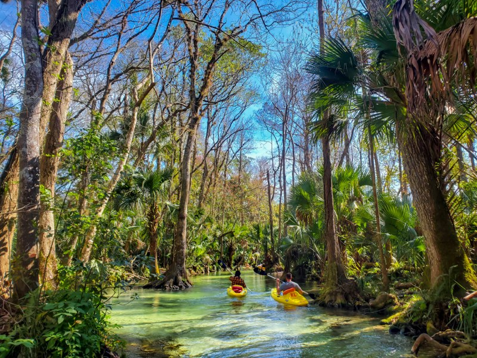 | 当天主线 · [King’s Landing](https://www.kingslandingfl.com/daypaddlekayakrentals) |
| **Mount Dora 灯塔与湖边** 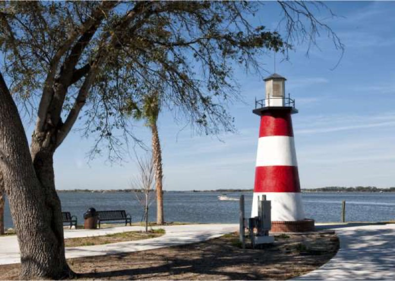 | 可选短逛 · [Florida Lighthouse Association](https://www.floridalighthouses.org/faux-lighthouses/mount-dora-lighthouse/) |

<!-- project-photos:end -->

**今天看什么：** 上午是比较紧凑的清水森林，午后换成湖畔小镇。和周三的河景相比，今天更偏“清泉照片＋坐着吃饭＋湖边散步”。  
**推荐路线：** 民宿 → King’s Landing → Pisces Rising 午餐 → 灯塔／老街二选一 → 民宿。  
**强度：** 中低到中等；加 Mount Dora 会比原版晚回约 1–2 小时。想最轻松就划完直接吃简餐回去。

#### 当天时间表

| 时间 | 去哪里／做什么 | 执行细节 |
| --- | --- | --- |
| 08:00–08:20 | 民宿早餐 | 换适合划船的衣服，带干衣裤和毛巾 |
| 08:20–09:30 | 开往 King’s Landing | 从度假区粗估 50–80 分钟，按民宿位置决定是否更早出发 |
| 09:30–10:00 | 停车、签到、路线说明 | 目标订 **10:00 左右**下水；提前多久到按确认信 |
| 10:00–12:00／12:30 | **只划 Emerald Cut 上游段** | 去程逆流，回程顺流；不要求划到最尽头，觉得累就折返 |
| 12:00／12:30–12:45 | 还船、换衣、补水 | 若拖到 13:00 以后，先确认午餐仍来得及，不再硬赶所有小镇点 |
| 12:45–13:30 | 开往 Mount Dora | 粗估 **30–45 分钟**，另留找车位时间 |
| 13:30–14:30 | **Pisces Rising 午餐** | 想看湖可请求有视野座位；冷风天室内更舒服。建议提前订约 13:30，确认改迟条件 |
| 14:30–15:20 | **选一条短逛线** | A 灯塔＋湖边；B 老街＋Sunset Park。只选一条就够 |
| 15:30 左右 | 开始回民宿 | 返程粗估 1–1.5 小时，不等日落；给周五留睡眠 |
| 16:30–17:00 后 | 民宿休息 | 洗衣、洗澡、收拾第二天物品；晚餐在附近解决 |

#### Emerald Cut：在哪一段划、怎么拍

- **出口右转，上游方向才是本版重点。** 去程逆流慢划，到了允许的折返点再顺流返回原租船点。前 15–20 分钟先适应操控，不急着拍照。[官方 Day Paddle 路线](https://www.kingslandingfl.com/daypaddlekayakrentals)
- **不要求把租船的 4 小时用满。** 4 小时是产品可用上限；本版目标约 2–2.5 小时，只走上游一侧，不再加左侧下游段。
- **照片拍什么：** 清水里的沙底、树枝形成的绿色通道、船头与水面倒影；两船之间留距离，找不挡航道的位置短停。清澈度会受水位、降雨等影响，不承诺能复刻网图。[Simply Wander 游记](https://justsimplywander.com/kings-landing-florida/)
- **不要误订 Shuttle Run 长线。** 订原点往返的 Day Paddle，或合适的短线导览。当前官方租赁页列双人 kayak **$74／艘**、单人 **$54／艘**，一双一单合计 **$128，税与订票费另计**；三人 canoe 列 **$64／艘**，但船型与载重须适合三人，最终以结账页为准。[官方产品、价格与载重](https://www.kingslandingfl.com/daypaddlekayakrentals)

#### 午餐首选：Pisces Rising

**为什么放这里：** 位于 Mount Dora 湖边老城，吃完就能散步；从船上下来后，午餐本身就是休息，不再找一个远处景点。

- **地址：** 239 W 4th Ave, Mount Dora, FL 32757。
- **已查到的周四午餐时段：11:30–15:00**，晚餐 17:00 再开。因此不把午餐排到 15:00 才到。[官网营业时间](https://www.piscesrisingdining.com/about/)
- **建议点法：** 三人共享一份 crab cakes 或 coconut shrimp，主食选鱼三明治、汉堡／沙拉；想吃得正式一点再考虑 shrimp & grits。菜单会调整，当天午餐可点范围以服务员说明为准。[官方菜单](https://www.piscesrisingdining.com/menu/)
- **预算：** 简单午餐约 **$25–40／人**；点多份海鲜正餐会更高。
- **座位：** 可提前请求湖景或露台，不能保证；12 月若风大优先室内。
- [餐厅官网／预订入口](https://www.piscesrisingdining.com/) · [导航](https://www.google.com/maps/search/?api=1&query=Pisces+Rising+239+W+4th+Ave+Mount+Dora)

**午餐踩空提醒：** 同附近的 Back Porch Pizza Bar 看起来很适合轻松吃，但官网列 **周四 16:00 才开**，不作为这天午餐备选。若 Pisces 订满或延误，直接用实时地图找营业中的附近简餐，不为等下午开门耗到傍晚。[Back Porch 官方时段](https://www.backporchpizzabar.com/contact/)

#### 午饭后选哪条路

| 路线 | 具体去哪 | 时间与取舍 |
| --- | --- | --- |
| **A：湖景优先，推荐** | 开车约 5–10 分钟至 **Grantham Point Park／Mount Dora Lighthouse** 附近合法停车，灯塔、湖岸长椅、码头方向拍照 | 留 **30–40 分钟**；重点是湖景和红白灯塔，拍完坐一会儿就回。不要把公园之间的步行往返当成没有时间成本 |
| **B：走路更少** | 午餐后从 **Sunset Park** 湖边到 **Donnelly Street、4th／5th Avenue** 附近走一小圈 | 留 **30–45 分钟**，有喜欢的店就进去；咖啡看见合适的再买，不追另一家网红店 |
| **A 的加量项，非主线** | 灯塔附近的 **Palm Island Park**，只走开放的湖边木栈道前段 | 额外 **20–30 分钟**；前两天水上活动已累就跳过。开放区以现场为准，不需要走完整圈 |

Palm Island 的地址为 **411 S Tremain St**，市政府列有木栈道、步道和停车设施；它与灯塔可组合，但本版只把它当体力好时的加量项。[市政府公园资料](https://www.mountdora.gov/Facilities/Facility/Details/11)  
[King’s Landing 导航](https://www.google.com/maps/search/?api=1&query=Kings+Landing+5722+Baptist+Camp+Road+Apopka+FL+32712) · [灯塔导航](https://www.google.com/maps/search/?api=1&query=Grantham+Point+Park+Mount+Dora+Lighthouse) · [Sunset Park 导航](https://www.google.com/maps/search/?api=1&query=Sunset+Park+Mount+Dora+Florida)

**如果不想连划两天：** 周四取消 King’s Landing，只做 **11:30 左右 Mount Dora 午餐＋湖边／小镇**，下午回民宿。取消船位先看条款；单纯去 King’s Landing 停车区走一圈，通常无法获得 Emerald Cut 的主要景观。

**周四晚餐可选：Columbia Celebration 店。** 仅在你们民宿靠迪士尼／Celebration，且真想出门吃饭时考虑；若住环球北侧，先看导航再决定，不额外往南绕。地址 **649 Front St, Celebration**；官网列周四 **11:00–21:00**，湖边环境适合早晚餐，预算 **$30–50／人**。周五若会吃 Sarasota 同品牌店，这晚就换民宿附近简餐，避免重复。[官方分店与预订](https://www.columbiarestaurant.com/celebration)

### 12/11 周五｜Sarasota 博物馆＋海滩详版，或 Winter Park 恢复日

<!-- project-photos:start -->
#### 当天项目图片

图片对应当天行程；“可选”和 A／B 路线仍按原计划取舍。图片为项目与景观参考，不代表当天运营、天气或观看位置。

| 项目与图片 | 行程定位／图片来源 |
| --- | --- |
| **The Ringling 美术馆** 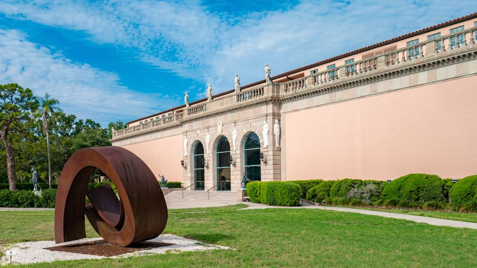 | B · Sarasota 长途版 · [The Ringling](https://www.ringling.org/) |
| **Lido Beach 海滩** 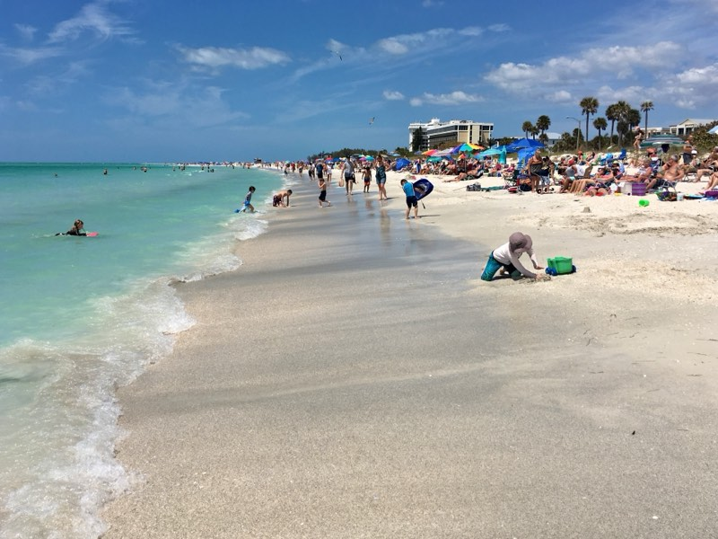 | B · Sarasota 长途版 · [Fred Hsu / Wikimedia Commons](https://commons.wikimedia.org/wiki/File:2017_Sarasota_Lido_Key_Beach_2_FRD_9567.jpg) · [CC BY-SA 3.0](https://creativecommons.org/licenses/by-sa/3.0/) · 缩小尺寸并压缩 |
| **Winter Park 湖区风景** 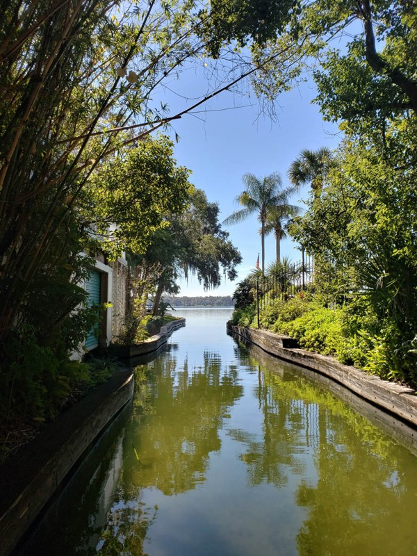 | A · 轻松版 · [Scenic Boat Tours](https://www.scenicboattours.com/) |
| **Scenic Boat Tour** 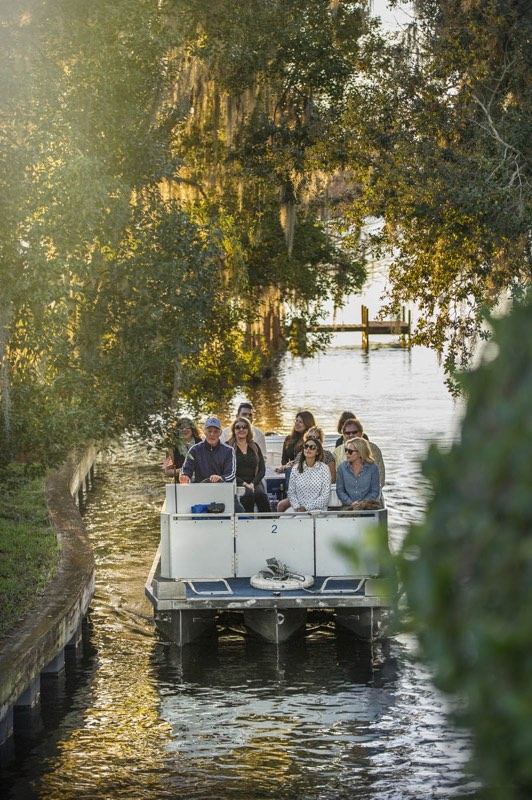 | A · 可选坐船 · [Scenic Boat Tours](https://www.scenicboattours.com/) |

<!-- project-photos:end -->

**怎么选：** 三人都想去 The Ringling、天气值得、司机愿意接受长途，就选 B；若更在意“不太累”，选 A。B 的往返驾驶预留 **5–6 小时或更久**，不会因看馆看海节奏慢而变成轻松交通日。

#### A. Winter Park 轻松版：早午餐 → 坐船看湖 → Park Avenue

**路线：** 民宿 → Briarpatch 或 Prato → Scenic Boat Tour（可选）→ Central Park／Park Avenue → 民宿。  
**拍照重点：** 橡树、公园、街边建筑；坐船时看湖与水道。陆上步行控制在约 1 小时内。

| 时间 | 具体安排 |
| --- | --- |
| 09:30–10:30 左右 | 慢慢出发去 Winter Park，停车；度假区粗估 35–60 分钟，加找车位缓冲 |
| 10:30–11:45 | **Briarpatch 早午餐**；若更想吃意大利菜，改 **11:30 Prato**，前面先逛公园 |
| 11:45–12:30 | 沿 Park Avenue 和 Central Park 短逛；想坐船就提前往码头走 |
| 13:00–14:00 | **Scenic Boat Tour 可选**：坐着看湖和水道；当天排队情况不合适就取消 |
| 14:00–15:00 | 公园坐一会儿／小店随逛，买杯饮料；不再另开车找远处拍照点 |
| 15:00–16:00 左右 | 回民宿，休息、收行李；如果要周五本地还车，就按门店时间提前回 |
| 晚上 | 附近简单晚餐，核对次日 18:30 航班和还车要求 |

| 餐厅 | 建议点什么／适合谁 | 地址、营业与预算 |
| --- | --- | --- |
| **Briarpatch：想要早午餐就选它** | 三人可点一份蓝莓柠檬松饼／法式吐司分享，再选鸡蛋或咸口早餐；别三个人都只点甜食。餐厅对着 Central Park，吃完就能逛 | **252 N Park Ave**；官网列周五 **07:30–16:00**。预算 **$25–40／人**；若等待超过约 30 分钟，按是否还有船班决定换店。[营业地址](https://thebriarpatchrestaurant.com/hours-and-location)／[早午餐菜单](https://thebriarpatchrestaurant.com/food-and-drink/brunch) |
| **Prato：更想吃午餐就选它** | 意大利菜，可按午餐菜单选意面、披萨等，三人分享；适合坐下慢慢吃一餐 | **124 N Park Ave**；官网列午餐 **每天 11:00–16:00**。预算 **$30–45／人**，建议订位。[官网、菜单与预订](https://www.pratoitalian.com/winter-park/) |

**船游执行：** 码头 **312 E Morse Blvd**，从 Park Avenue 步行约 10–15 分钟，留足往返时间。官网列 **10:00–16:00 整点出发、约 1 小时**，普通散客**先到先得**；建议提前 20–30 分钟询问余位，13:00 只是目标班次，不是已预约。官网成人含税 **$20／人，三人 $60**，以当天售票为准。[船游官网](https://scenicboattours.com/)

**停车：** 找 Park Avenue 周边公共停车位／车库，按现场限时和收费牌示执行；停好后尽量整段步行，不因换餐厅反复挪车。不把码头旁车位当作能停一整天的默认方案。  
[Briarpatch 导航](https://www.google.com/maps/search/?api=1&query=Briarpatch+252+Park+Avenue+North+Winter+Park) · [Prato 导航](https://www.google.com/maps/search/?api=1&query=Prato+124+N+Park+Avenue+Winter+Park) · [船码头导航](https://www.google.com/maps/search/?api=1&query=Scenic+Boat+Tour+312+E+Morse+Blvd+Winter+Park)

#### B. Sarasota 风景版：The Ringling → Columbia 午餐 → Lido Beach 日落

**推荐这条组合的原因：** 博物馆、吃饭和海滩都放在 Sarasota 一带；不再绕去 Tampa 市中心、Clearwater 或 Siesta Key。适合认真想看 The Ringling，同时希望有一段海边坐着的时间。

**路线：** 民宿 → The Ringling → St. Armands Circle 的 Columbia Restaurant → Lido Beach 主海滩 → 原民宿。

| 时间 | 具体安排 | 要留的缓冲 |
| --- | --- | --- |
| 06:45–07:15 | 民宿吃早餐、装好毯子／外套／水 | 行李留民宿，不换酒店 |
| **07:15 出发** | 开往 The Ringling | 驾驶预留 2.5–3 小时，加一次短休；堵车就压缩馆内支线 |
| 10:00–10:30 | 到访客入口、停车、入场 | 按真实开放时间与预约；若需等开门，就先休息，不乱走私密区域 |
| 10:30–13:00 | **美术馆庭院＋精选展厅＋海湾花园／豪宅外观** | 建议游览约 2.5 小时；不要试图四个馆全看 |
| 13:00–13:45 | 开车去 St. Armands Circle，停车 | 预留约 25–45 分钟及停车，过桥交通可能变慢 |
| **13:45–15:00** | **Columbia Restaurant 午餐** | 建议订 13:45–14:00 左右，按路况调整；三人留约 75 分钟 |
| 15:00–15:20 | Circle 周边走一小圈 | 咖啡／小店看兴趣，想多躺海滩就直接跳过 |
| 15:20–15:45 | 移车到 Lido Beach 主海滩停车区 | 留停车和走到沙滩时间；不拖到日落前才找车位 |
| **15:45–17:50** | **海滩坐着、散步、拍日落** | 前一小时休息，约 16:45 后拍金色光线；12/11 日落约 17:36 |
| 17:50–18:15 | 洗手间、换鞋、拿好车上用品，开始返程 | 回程驾驶前先确认司机状态 |
| 20:45–22:00 左右 | 回到民宿 | 含粗估车程和一次简短补给；如堵车可能更晚 |

**这天午餐晚：** 博物馆里带允许携带的简单零食，在允许的休息区吃；不要从早餐一直饿到 14:00。博物馆迟到半小时，先砍额外展厅和 Circle 逛店，不砍掉全部海滩休息。

##### The Ringling：只挑你们最值得看的部分

**建议走法：** McKay Visitors Pavilion 办入场 → Museum of Art 庭院及一部分展厅 → 按现场开放步道去 Bayfront Gardens／Ca’ d’Zan 海湾方向 → 回访客入口取车。实际顺序按当日入口、开放区域和馆内地图调整；不要把草坪或外观区域默认视为免票。

| 看点 | 建议时间 | 怎么看／怎么拍 |
| --- | --- | --- |
| **美术馆庭院** | 30–40 分钟 | 拱廊、雕塑、庭院纵深；先拍三人合照，再轮流拍单人。以现场摄影规定为准 |
| **精选展厅** | 30–40 分钟 | 看你们最有兴趣的一部分，留室内休息；不逐厅打卡 |
| **Bayfront Gardens＋Ca’ d’Zan 外观方向** | 45–60 分钟 | 榕树、花园与海湾建筑；包含到达／返回的移动时间预算，走累就缩短 |
| **卫生间、坐下休息、回程** | 20–30 分钟 | 给园区里的距离留时间，不把 2.5 小时全算成拍照时长 |

这套筛选参考 Sarasota 旅游局的庭院、展厅、海湾花园走法，符合你们更重视建筑和风景的偏好。[旅游局 Ringling 参观攻略](https://www.visitsarasota.com/article/starters-guide-ringling)

**票务取舍：** 想进 Ca’ d’Zan 室内，先确认票项、开放和时段，并用它替换部分展厅；不在 2.5 小时外再硬加一场完整导览。Circus Museum 只在三人特别感兴趣时加入，也要替换其他部分。**12/11 的准确开放区域、票价和入场包含范围，本次仍未能从官方票务页完整读取**，先别凭旧攻略付款。[The Ringling 官网](https://www.ringling.org/)

**导航与停车：** **5401 Bay Shore Rd, Sarasota, FL 34243**，按 The Ringling／Visitors Pavilion 入口标识走，预留 15–20 分钟找车位、步行和票务；停车收费／限制以现场为准。不要导航去名称相近的 Ringling College。[官方旅游局地址](https://www.visitsarasota.com/attractions-tours/ringling) · [导航](https://www.google.com/maps/search/?api=1&query=The+Ringling+5401+Bay+Shore+Road+Sarasota)

##### 午餐：Columbia Restaurant，明确选 St. Armands Circle 店

**这是本日首选。** Spanish／Cuban 风格，位于去海滩前适合吃饭的街区；选它主要是顺路、能坐下来休息，以及三人容易分享点餐。

- **地址：** **411 St. Armands Cir, Sarasota, FL 34236**；不是 Tampa 的 Ybor City 店，也不是奥兰多 Celebration 店。
- **营业：** 官网列周五 **11:00–22:00**，午餐时段不用担心下午关门，但仍建议预订。[分店官网与预订](https://www.columbiarestaurant.com/st-armands-circle-sarasota)
- **三人建议点法：** 选 Original Cuban Sandwich、1905 Salad、Half and Half Combo／一份喜欢的主菜，再按食量加汤；先问沙拉份量，避免三个人都点大沙拉。当前官网午餐菜单有这些选择，最终以当天菜单为准。[官方午餐菜单](https://www.columbiarestaurant.com/_files/ugd/28e529_67a7a404fcfa4a0ba7fe9b218e9c001f.pdf)
- **预算：** 简单午餐约 **$25–40／人**；海鲜大菜、酒水另算。司机选择无酒精饮品。
- **停车：** 先找 Circle 合法公共车位／车库，预留 10–15 分钟；不要默认餐厅带专属停车，也不要把餐厅附近车位一直停到日落。
- [餐厅导航](https://www.google.com/maps/search/?api=1&query=Columbia+Restaurant+411+St+Armands+Circle+Sarasota)

**等位太久的备选：** 不等超过约 30 分钟；可改 Lido Beach Pavilion 的 **Lido Island Grill** 简餐，先确认当日是否营业。市政介绍列有该餐饮点，但本次未核实 12/11 菜单和时段，所以不作为必须依赖的正餐；备点零食。[市政设施介绍](https://www.letsplaysarasota.com/facilities/lido-beach-pool-and-pavilion)

##### 海滩：去主海滩 Pavilion，不另找隐秘入口

- **导航：Lido Beach／Lido Beach Pavilion，400 Benjamin Franklin Dr, Sarasota。** 这里有卫生间、海滩入口等设施，适合三人坐着看海；本版不另加 South Lido 自然公园。[县公园资料](https://www.sarasotacountyparks.com/Home/Components/FacilityDirectory/FacilityDirectory/569/)
- **停车：** 市政页面列有紧邻海滩的免费停车；最终按当天标识执行，路边车位和 Circle 车库不要混为同一规则。[市政设施与停车说明](https://www.letsplaysarasota.com/facilities/lido-beach-pool-and-pavilion)
- **15:45–16:45：** 找舒服位置坐着，喝水、看海、轮流短走；不要求一直拍照。
- **16:45–17:50：** 拍低角度光线、三人剪影、海岸线和日落。12/11 预计约 **17:36** 日落，之后再留十来分钟颜色变化。[日落表](https://www.timeanddate.com/sun/usa/sarasota?month=12&year=2026)
- **带什么：** 轻毯／坐垫、挡风外套、水和小零食。12 月风大就缩短，不把游泳和夏季躺晒写成保证体验。

**晚餐怎么解决：** 午餐若 15:00 才结束，傍晚先用轻食，不再坐下吃一顿 90 分钟的正式晚餐。返程沿实际导航选营业中的简餐点，或回民宿点外卖；不预设一定来得及回奥兰多某家店堂食。若三人更重视海边晚餐，可提前离开海滩吃饭，但应放弃完整日落，而不是拖到很晚再开始长途返程。

### 三天最后怎么选：我的实际建议

| 你们到时的状态 | 推荐执行 |
| --- | --- |
| 想保留全部自然体验，体力正常 | 周三短线＋Ocala；周四短线＋Mount Dora 只选灯塔；周五 Sarasota |
| 最重视“不累”，仍想看博物馆与海滩 | 周三短线；周四取消第二次划船，只做 Mount Dora 午餐／湖边；周五 Sarasota |
| 前四天乐园已明显走累 | 周三园内午餐早回；周四短线或本地休息；周五 Winter Park |

建议优先考虑第二行：**Silver Springs 划一次水，Mount Dora 轻松看湖，Sarasota 看馆看海**。它比连续两天划船再接一整天长途，更接近你们后半程看风景的目标；King’s Landing 的船位若已订，须先看取消条款再改。

### 12/12 周六｜附近早午餐、还车、MCO 18:30 起飞

**主线：把返程做从容，不从海边或清泉景点赶飞机。**

| 时间 | 安排 |
| --- | --- |
| 08:30–09:45 | 起床、早餐、检查行李与退房要求；暂定房源要求 10:00 前退房 |
| 09:45–10:00 | 完成退房，行李带上车；寄存或延迟退房须先获得房东确认，不默认可用 |
| 10:00–12:30 | 附近简单早午餐、休息；行李随车，不再排需要长时间停车的景点 |
| 12:30–13:30 | 核对航班、加油／充电要求，准备往机场方向走 |
| 约 14:00 前后 | 从度假区出发；目标 **15:00 左右到机场租车还车处**，留出拥堵与找路余量 |
| 约 15:30–16:00 | 完成还车、到正确航站楼、办理值机／托运；按航空公司要求再提前 |
| 18:30 | 国内航班起飞；以实时航班状态为准 |

以上是主动留宽的返程安排，不能代替航空公司的托运／登机截止时间。**租车合同的还车截止时间也要单独满足**；机场外门店须增加接驳时间。

如果周五已在本地门店还车，周六就打车去 MCO，仍以约 15:30 到正确航站楼为目标；不为了省掉还车把上午重新排满。

## 5. 交通和租车：只租后半段

### 12/4–12/8：机场与乐园打车

- 抵达日机场 → 民宿；四个乐园日各一趟往返。三人合乘，比较车型、行李空间和实时价格。
- 暂定住 Reunion Resort 一楼公寓，属于迪士尼西南侧；具体门牌尚待订单确认，不写固定车费或精确导航车程。环球三天先按 45–60 分钟路上缓冲，另留叫车、安检和步行时间；前一天晚上和当天出门前再查导航。
- 环球旧双园与 Epic 的下客地点不同；每次核对 App 的目的地与指定上车点。
- 开园前和散场时要加缓冲。等待贵或拥堵时，在允许的区域坐着等一会儿，不步行去不适合上下客的道路边。

### 12/9–12/12：建议先比较两种报价

| 方案 | 适合情况 | 要核对什么 |
| --- | --- | --- |
| **附近门店取，MCO 还** | 希望周六直接开去机场；本版主交通方案 | 单程还车费用、营业时间、实际机场内外位置、跨还车时刻是否多计一天 |
| **附近门店取还，周五还车** | 周五采用本地轻松版，想减少租车天数 | 周五还车时间、回民宿与次日去机场两段打车总价 |

租车按合同计费，不按日历简单算“周三到周六就是三天”。例如周三上午取、周六下午还可能超过三个 24 小时，按报价比较总额。若周五去 Sarasota，通常难赶附近门店下班前还车，优先保留到周六机场还。

### 周边单程驾驶预算（仅规划估计）

| 路段 | 预留车程 |
| --- | --- |
| 迪士尼／环球度假区 → Silver Springs | 约 1.5–2 小时 |
| 度假区 → King’s Landing | 约 50–80 分钟 |
| 度假区 → The Ringling | 约 2.5–3 小时，拥堵可能更久 |
| The Ringling → Lido Beach | 约 25–45 分钟，另加停车 |
| 度假区 → Winter Park | 约 35–60 分钟 |
| 度假区 → MCO | 约 30–60 分钟，另留拥堵余量 |

这些不是实时路况，也未按民宿门牌计算；拿到地址后应重新核对。收费道路、油费、停车与额外驾驶员费用计入租车总预算。

## 6. 餐饮节奏：围绕当天主线

| 场景 | 建议 |
| --- | --- |
| 乐园早餐 | 民宿简单吃或带轻食出门，减少早上出门环节 |
| 乐园午餐 | 就近选能坐下的餐点，每天至少一顿完整休息 |
| Studios 周日 | 按巡游时间吃早晚餐，回民宿后不再找远餐厅 |
| Epic | 午餐长休息＋较早晚餐，避免把蓝调和夜景时段全花在吃饭上 |
| EPCOT | 午餐 Connections Eatery，法国馆 Les Halles 加餐；晚餐在 T−90 分钟前完成，不挤占烟花选位 |
| 两个清泉日 | 带水与简单零食，上岸换衣后再午餐；不额外绕城找餐厅 |
| Sarasota 可选日 | 午餐／早晚餐在博物馆和海滩周边解决，司机状态优先 |

周三至周五已加入具体餐厅、菜单方向、营业信息与导航，详见每日安排；没有查询实时餐厅空位，也没有代订。

## 7. 预约与临近复核清单

<!-- booking-overview:start -->
### 预订概览

当前链接为预订／查询入口，可替换为电子票或订单链接。

| 日期 | 项目 | 人数／安排 | 链接 |
| --- | --- | --- | --- |
| 12/4–12/12 | Reunion 一楼公寓 | 3 人 · 8 晚 | [查看](https://www.airbnb.cn/rooms/934030452168483857?check_in=2026-12-04&check_out=2026-12-12&adults=3) |
| 12/9–12/12 | 周边游租车 | 取还点、供应商待定 · Alamo 查询入口 | [查看](https://www.alamo.com/) |
| 12/5–12/7 | 环球三日门票 | 3 人 · 旧双园跨园 2 天＋Epic 1 天 | [查看](https://www.undercovertourist.com/orlando/universal-2-park-2-day-park-to-park-plus-1-day-epic-universe-ticket/) |
| 12/5–12/7 | 环球三日 Express | 3 人 · 三园普通 Express | [查看](https://www.undercovertourist.com/orlando/universal-3-day-universal-express-pass-ticket/) |
| 12/8 | EPCOT 一日门票 | 3 人 | [查看](https://disneyworld.disney.go.com/admission/tickets/theme-parks/) |
| 12/8 | EPCOT Lightning Lane Multi Pass | 3 人 · 优先预约料理鼠王 | [查看](https://disneyworld.disney.go.com/lightning-lane-passes/) |
| 12/8 | 银河护卫队 Single Pass | 3 人 · 单独购买 | [查看](https://disneyworld.disney.go.com/lightning-lane-passes/) |
| 12/9 · 11:30 左右 | Silver Springs 短线 kayak | 3 人 · 时段待订 | [查看](https://silversprings.com/plan-your-day/paddling/) |
| 12/10 · 上午 | King’s Landing · Emerald Cut | 3 人 · Day Paddle 原点往返 | [查看](https://www.kingslandingfl.com/daypaddlekayakrentals) |
| 12/11 · B 路线 | The Ringling | 可选 · Sarasota 版 | [查看](https://www.ringling.org/) |
| 12/11 · A 路线 | Winter Park Scenic Boat Tour | 可选 · 官网列先到先上船 | [查看](https://scenicboattours.com/) |

<!-- booking-overview:end -->

### 现在先落实

- [ ] 环球三日票：完整名称、三园包含范围、12/5–12/7 有效、改日规则、跨园权限。
- [ ] EPCOT：12/8 票；核对预约要求，提前关联三人 My Disney Experience。
- [ ] 若决定购买迪士尼 LL：按民宿＋单日日期票当前窗口，12/5 07:00 EST 查看 Guardians Single Pass 与 Multi Pass 的 Remy；核对三人时段，勿与环球 Express 混淆。
- [ ] 租车：12/9 附近取车的营业时间，比较 12/12 MCO 还与 12/11 本地还的总成本。
- [ ] Silver Springs：选择能衔接取车的 **11:30 左右**可订短线时段；按三人订足船位。
- [ ] King’s Landing：选择 **12/10 上午**，确认短线产品、船型和取消条款。
- [ ] 若决定 Sarasota：查 The Ringling 当日开放区域、票项与 Ca’ d’Zan 参观规则。

### 出发前约一周

- [ ] 查 12/5–12/8 各园正式营业时间、维修、巡游与演出场次；本版时段随之微调。
- [ ] 查 Epic 目标项目和 Express 覆盖范围，核对三人日期和产品。
- [ ] 复核 Disney LL 购买窗口及 Remy／Guardians 覆盖；确认 12/8 Luminous 开演时间 T，安排 T−75 分钟找位、T−60 分钟基本定点。
- [ ] 确认 Reunion 公寓订单、门牌、门禁／网约车进入方式、晚到入住；12/12 按 10:00 前退房，行李随车。核对租车取还地址。
- [ ] 两个水上项目的 waiver、提前到场要求和证件要求按确认信准备。

### 出发前 48–72 小时

- [ ] 看温度、风雨与运营提醒，再确认水上活动和海滩是否合适。
- [ ] 若要换环球三园顺序，先确认票的日期限制和 Epic 入园权限；EPCOT 换日另核对改票条件。
- [ ] 周四晚上决定周五 A／B；如相关预约取消期限更早，就提前做决定。

## 8. 天气与体力的临场取舍

| 情况 | 当天怎么改 |
| --- | --- |
| 周五抵达很晚 | 周六不抢开门，冒险岛少刷项目；先保证睡眠 |
| Epic 当天恶劣天气 | 仅在票务允许时与另外一个环球日交换；尽量给 Epic 留更完整天气窗口，不擅自假设可改票 |
| 乐园遇短时降雨 | 用室内项目、演出、餐饮休息衔接；户外项目恢复以官方现场为准 |
| 连玩四天脚累 | Silver Springs 改玻璃底船；King’s Landing 可取消，按取消条款执行 |
| 清泉项目遇不适合下水的天气／停运 | 先联系商家；不要把玻璃底船当作保证运行的替代；可换本地休息日 |
| 周五海边冷、风大、下雨 | 选 Winter Park／民宿休息；如只想看馆，可专程去，但仍要接受长途驾驶 |
| 周六返程日 | 不补清泉、海滩、博物馆或乐园；行李与到机场优先 |

### 恢复优先版（在买票前就决定）

如果你们想要一个完整休息日夹在乐园中间，可采用：

**12/5 冒险岛 → 12/6 本地休息 → 12/7 Epic → 12/8 Studios → 12/9 EPCOT → 12/10 Silver Springs → 12/11 King’s Landing → 12/12 返程。**

这版取消 Sarasota，环球三日跨 12/5–12/8，**必须确认所购票有效窗口覆盖这四天**，同时将 EPCOT 票选为 12/9。租车改为 12/10 开始。若喜欢“前半段集中玩、后半段看风景”，仍选主版本。

## 9. 简洁打包单

- **每天：** 好走的鞋、充电宝、薄外套、水、少量零食、雨具、证件。
- **乐园拍照：** 手机镜头擦拭布；衣服以舒适和便于加外套为先，不为了换装多背一个大包。
- **水上两天：** 按活动要求穿衣和救生衣，防水袋、毛巾、干衣裤、眼镜固定绳；上岸后及时换干。租赁证件要求按确认信。
- **海滩可选日：** 轻便坐垫／毯子、挡风外套、水；12 月以看海和日落为目标。
- **自驾：** 驾照、租车所需证件与支付卡、手机导航和充电线；额外驾驶员须在租车合同中登记。

## 10. 常用入口

| 用途 | 链接 |
| --- | --- |
| 环球促销购票 | [旧双园两日跨园＋Epic 一日](https://www.undercovertourist.com/orlando/universal-2-park-2-day-park-to-park-plus-1-day-epic-universe-ticket/) |
| 三日 Express | [三日三园 Express](https://www.undercovertourist.com/orlando/universal-3-day-universal-express-pass-ticket/) |
| EPCOT 购票 | [官方日期选择器](https://disneyworld.disney.go.com/admission/tickets/theme-parks/) |
| Disney LL | [产品与购买规则](https://disneyworld.disney.go.com/lightning-lane-passes/) |
| 冒险岛排队 | [当日实时队列](https://queue-times.com/en-US/parks/64/queue_times) |
| Studios 排队 | [当日实时队列](https://queue-times.com/en-US/parks/65/queue_times) |
| Epic 排队 | [当日实时队列](https://queue-times.com/en-US/parks/334/queue_times) |
| EPCOT 排队 | [当日实时队列](https://queue-times.com/en-US/parks/5/queue_times) |
| 环球门票 | [Universal Orlando 官方门票](https://www.universalorlando.com/web/en/us/tickets-packages/park-tickets) |
| Epic 园区 | [Epic Universe 官方页](https://www.universalorlando.com/web/en/us/theme-parks/epic-universe) |
| 冒险岛 | [Islands of Adventure 官方页](https://www.universalorlando.com/web/en/us/theme-parks/islands-of-adventure) |
| Studios | [Universal Studios Florida 官方页](https://www.universalorlando.com/web/en/us/theme-parks/universal-studios-florida) |
| EPCOT | [EPCOT 官方页](https://disneyworld.disney.go.com/destinations/epcot/) |
| EPCOT 节日 | [Festival of the Holidays](https://disneyworld.disney.go.com/events-tours/epcot/holiday-festival/) |
| Silver Springs | [官方划船产品](https://silversprings.com/plan-your-day/paddling/)／[导航检索](https://www.google.com/maps/search/?api=1&query=5656+E+Silver+Springs+Blvd+Silver+Springs+FL+34488) |
| King’s Landing | [官方短线租船](https://www.kingslandingfl.com/daypaddlekayakrentals)／[导航检索](https://www.google.com/maps/search/?api=1&query=Kings+Landing+5722+Baptist+Camp+Road+Apopka+FL+32712) |
| The Ringling | [官网](https://www.ringling.org/)／[导航检索](https://www.google.com/maps/search/?api=1&query=The+Ringling+5401+Bay+Shore+Road+Sarasota+FL) |
| Lido Beach | [导航检索](https://www.google.com/maps/search/?api=1&query=Lido+Beach+Sarasota+FL) |
| Winter Park | [Central Park 官方介绍](https://cityofwinterpark.org/departments/parks-recreation/parks-playgrounds/parks/central-park/)／[导航检索](https://www.google.com/maps/search/?api=1&query=Central+Park+Park+Avenue+Winter+Park+FL) |

---

**执行优先级：** Epic 的完整体验与照片 → 冒险岛 → EPCOT 的料理鼠王、银河护卫队与烟花 → Studios 精选 → Silver Springs → King’s Landing → Sarasota 可选长途日。需要删减时，先删额外长途和重复划船，把民宿休息时间真正留下来。

本文件是规划，不代表门票、船位、餐厅或租车已预订。官方已核实的节日日期和产品说明附在对应段落；精确营业时间、空位、报价与实时路况仍需按出行日期复核。
